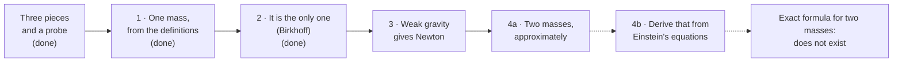

# Where this could go

Plan of 22 November 2026, written at the end of the session that produced this repository.
Marks as in [SURVEY.md](SURVEY.md): **Measured**, **Worked out**, **Open**, **Not verified**.
Effort is counted in agent-hours: one hour of one AI worker proving and compiling.

## Status

**Step 1 is done** (23 November 2026). It took 28 minutes and three builds, against an estimate of
5 to 20 agent-hours. See "What step 1 showed" below.

**Step 2 is done** (23 November 2026). It took about 20 minutes and six builds, against an
estimate of 20 to 60 agent-hours. See "What step 2 showed" below.

**The starting shape of step 2 is no longer assumed** (also 23 November 2026). "Looks the same
from every side" is now where the proof begins. That took about an hour and a half. See "What the
starting shape showed" below.

**The formulas no longer depend on the coordinates on trust** (also 23 November 2026). Curvature,
free fall and "unchanged by a turn" are each proved to give the same answer in any coordinates.
That took about an hour. See "What the coordinate question showed" below.

**Next, before step 3:** Birkhoff's theorem with no coordinates at all, as the first trial of a
small swarm. See "Next: Birkhoff's theorem with no coordinates at all" below.

## The short answer

- **Go, on a smaller target: "one mass, from the definitions"** (steps 1 and 2 below). It is cheap
  and very likely to work. As far as we could find, nobody has done step 2 by machine. Step 1 had
  been done in Lean before; this plan first missed that (see [SURVEY.md](SURVEY.md)).
- **No-go on an exact formula for two masses circling each other.** Such a formula almost
  certainly does not exist. It is not the goal of this project and should not become it.
- **Not now: deriving the two-body equations from Einstein's equations by machine** (step 4b).
  The tools it needs do not exist yet, and even on paper the starting point is not agreed.
- **If the two-body wish stays:** step 4a is the honest smaller target. It checks the well-known
  *approximate* equations for two masses and what follows from them.

## What today showed

| | | Mark |
|---|---|---|
| From "go" to three proved pieces, a probe and a tested judge | about 40 minutes, roughly 10 of them waiting for a download | Measured |
| Size | 34 theorems, about 590 lines; all 70 declarations audited | Measured |
| Model use for that | about 45 model turns; roughly $15 to $20 at list prices for the top model, about $10 for the regular one | Measured |
| Machine | this PC, one build at a time; a rebuild takes about 10 seconds | Measured |
| Tries needed | each piece compiled within a handful of tries; the probe took four | Measured |

A warning that belongs right here: these were the easy pieces, chosen to be easy. The pace will
not hold higher up.

## What step 1 showed

| | | Mark |
|---|---|---|
| From "go" to a green build | 28 minutes, three builds | Measured |
| Size now | 79 theorems, about 1,300 lines; all 189 declarations audited | Measured |
| Model use | 8 model turns; roughly $10 at list prices for the top model | Measured |
| Against the estimate | 5 to 20 agent-hours were estimated. The real figure was under half an hour. | Measured |

Why the estimate was so far off: it assumed each of the sixteen parts would need a hand-made
proof. Writing every entry as "a function of the distance times a function of the angle" let one
short recipe do all of them. That is a gain from the design, not luck in the proving.

## What step 2 showed

| | | Mark |
|---|---|---|
| From the details to a green build | about 20 minutes, six builds; the two that failed did so on small things (a name clash, three names left folded) | Measured |
| Size now | 145 theorems, about 2,400 lines; all 332 declarations audited | Measured |
| Model use | not measured this time | |
| Against the estimate | 20 to 60 agent-hours were estimated. The real figure was under half an hour again. | Measured |
| Swarm | none. FACTORY 0.11.0 could have run 3 teams of 10 on local Docker; it was not used, because one worker was enough and this PC builds one Lean project at a time | Measured |

Why it went fast again: the same design. Every entry of the length measure and of its connection
is "a function of time and distance, times a function of the angle", so the step 1 recipe carried
over. The new kinds of work turned out to be short, because the standard library already had
them: "slope zero everywhere means constant" and "the order of two slopes does not matter" were
each a single library theorem, and only had to be translated.

## What the starting shape showed

Step 2 had one assumption that could be removed with the tools at hand: the shape of the length
measure. Removing it meant three things: deriving the general round shape from the symmetry,
redoing the curvature for that shape (with a cross term and a free sphere size), and building the
change of coordinates inside the proof.

| | | Mark |
|---|---|---|
| From the question to a green build | about an hour and a half, roughly 40 small builds | Measured |
| Size now | 281 theorems, about 5,200 lines; all 631 declarations audited | Measured |
| Method | every formula was first worked out with a computer algebra tool (sympy), which is not trusted, and then proved in Lean, which is | Measured |
| What the standard library supplied | the hard analysis step, "two slopes that fit together come from one function" (Poincaré's lemma), is in the library since 2025 | Measured |
| Tries needed | the two largest computations (connection and curvature of the general shape) compiled on the first try; the errors were small ones in the glue | Measured |

Why it went fast: the unknown formulas are the risky part of such a computation, and the algebra
tool removed that risk before any Lean was written. Lean then only had to confirm.

What it means for the steps below: their hours are probably too high as well. But step 3 contains
kinds of work steps 1 and 2 did not: limits ("to first order"), and statements that first have to
be invented. Read the hours as upper limits until measured.

## What the coordinate question showed

Everything above computes with formulas in coordinates. The first item of "taken on trust" was
that these formulas mean the same in any coordinates. That is now proved, for all three of them.
It is a different kind of work from steps 1 and 2: a general statement about any length measure
in any number of coordinates, not a computation for one space-time.

| | | Mark |
|---|---|---|
| From the question to the curvature theorem | 28 minutes | Measured |
| With the worked cases, free fall and symmetry as well | about an hour in all, about 30 builds | Measured |
| Size now | 375 theorems, about 7,400 lines; all 749 declarations audited | Measured |
| Estimate beforehand | none had been made | |
| Tries needed | the curvature proof took most of the builds, again with small errors in the glue and none in the mathematics; the free-fall and the symmetry proof needed one small fix each, and their worked cases compiled on the first try | Measured |

How it was done: no index was pushed around by hand where a table could do the work. The
connections, their slopes and the full curvature were written as square tables, so that the
cancellation at the heart of the proof became a few lines of table algebra. The standard library
supplied the two facts from analysis: the chain rule, and "the order of two slopes does not
matter".

What it rests on, said plainly: the change of coordinates has to be smooth near the point and
must lose no direction there. Nothing is assumed about the inverse of the length measure beyond
its existence. That it is smooth is proved (`contDiffAt_of_inverse`).

Each of the three theorems was then tested on a case whose answer was already known by another
route: Eddington's way of writing the black hole. Its emptiness, its roundness and its
free-falling orbit all follow from Schwarzschild's coordinates through the new theorems, and all
three agree with what step 1 and step 2 had computed directly.

What is still open here, and could be closed with the tools at hand: the two directions of
Birkhoff's theorem ("empty and round, so Schwarzschild's in other coordinates" and
"Schwarzschild's in other coordinates, so empty") are proved separately. Joining them into one
"exactly when" needs the new time label to be shown three times differentiable, which asks for
one more degree of smoothness in the setting, and a version of step 1 inside the rim.

## Next: Birkhoff's theorem with no coordinates at all

Decided on 23 November 2026, before step 3: remove the last shortcut of step 2, with a small swarm
of workers. Step 3 waits.

**The goal.** A space-time is a curved space where time counts with the opposite sign to space.
Take one with four dimensions, that is empty, and that looks the same from every side: three
motions leave all lengths unchanged, combine the way turns do, and sweep out spheres. Then near
almost every point it is a piece of Schwarzschild's space-time. No coordinates are given at the
start; the proof has to find them.

**Why it is worth it.** It closes both items that are still "taken on trust" in the README at
once. Item 2, because the coordinates that fit the turns are no longer assumed. Item 1, because
the coordinate formulas for curvature and symmetry get tied to curvature defined on a curved
space, which is what the textbooks mean by them. And Lean's standard library has none of the
pieces this needs (see [SURVEY.md](SURVEY.md)), so they would be worth offering upstream on their
own. It is not new physics: the paper version is in Hawking and Ellis (1973), appendix B.

**The work, in five streams.**

| Stream | What | Needs first | Fits a swarm? |
|---|---|---|---|
| 0 · Definitions | A length measure with a time sign on a curved space; its connection; its curvature; "a motion that keeps all lengths"; "looks the same from every side". Each tested on cases with known answers (a sphere, de Sitter, Schwarzschild). | Nothing | No. One careful head, and a second reader |
| 1 · Coordinates that fit the turns ([#20](https://github.com/flujo-app/gravity-in-lean/issues/20)) | In coordinates: paths along a field that depend smoothly on where they start; Frobenius's theorem; any turning of a surface that combines like turns is, after relabelling, the turning of a globe. | Its statements only | Yes, a few big jobs |
| 2 · Curvature on curved spaces | The connection for a length measure with a time sign (the library's 414-line file assumes all lengths positive), curvature, Ricci's part of it, and how all of them behave under motions that keep lengths. | Stream 0 | Yes, many small jobs |
| 3 · The bridge | In any chart, each object of stream 2 equals the coordinate formula this repository already uses. | Streams 0 and 2 | Yes, many small jobs |
| 4 · Joining | The goal, from streams 1 and 3 and `birkhoff_of_round`, carried back by the "any coordinates" theorems. | Streams 1 and 3 | No |

Streams 1 and 2 can run side by side, so two teams can work from the start, and a third once
stream 3 opens. More teams than that would mostly wait for each other: five to ten teams would
not make it five to ten times faster.

**Machines, measured on 23 November 2026.**

| | | Mark |
|---|---|---|
| One Lean check that loads the library's curved-space parts | 6 seconds and 1.4 GB once the files are warm; 112 seconds the first time | Measured |
| One Claude Code worker on this PC | typically 0.2 to 0.35 GB; a long-running one up to 1.1 GB | Measured |
| Room on this PC | 8 processor threads, 32 GB of memory (13 GB free at the time), Docker allowed 19.5 GB, no containers running | Measured |

So Lean stays cheap and a build queue holds. This PC fits one team of ten with queued builds;
two would be tight. Five to ten teams would need cloud machines, which FACTORY can already start.
The real limit is the weekly model allowance, not the machine. FACTORY's own notes say to check
the AI plan's terms before running many agents on one subscription.

**Effort.** Not measured, and not like steps 1 and 2: those were calculations with known answers,
this is building general theory the library lacks. The first plan said months, at a person's
pace. A guess for a swarm: one to three weeks from start to finish, limited by the order of the
streams and by the allowance. Read it as a guess until the trial below has run.

**What the Riemann proof of November 2026 teaches here.** Its statement was already in the
standard library, so nobody had to trust a new definition; the work was all proof, and size was
no obstacle (17.4 million lines in about six weeks). Here it is the other way round. The proofs
are textbook material, and the risk is in the new definitions. That is why stream 0 is done by
one head, read twice, and tested on known answers before any worker starts.

**Order.**

1. Stream 0, and the statements of stream 1: one worker.
2. A build queue for the fleet: one Lean build at a time on this PC.
3. A trial: one team on stream 1. Measure jobs finished per hour and allowance used per hour.
4. Then decide how many teams, and whether any run in the cloud.

## The steps

| Step | What would be proved | What it needs first | Effort | Will it work? | Verdict |
|---|---|---|---|---|---|
| **1. One mass, from the definitions** | Compute the curvature of Schwarzschild's space-time from the general formulas (the ones the probe already uses), all 16 parts. Add the general equation for free fall and show the round orbit obeys it. This removes the first two "taken on trust" items in the README. | Nothing new. It is the probe again with four coordinates instead of two. | Estimated 5 to 20. Took under half an hour. | It did | **Done** |
| **2. It is the only one** (Birkhoff's theorem, in coordinates) | Any round, empty space-time is Schwarzschild's, even if you allow it to change in time. In particular a round star that pulsates makes no gravity waves. | Step 1, plus arguments of the kind "slope zero everywhere means constant", which the standard library has. | Estimated 20 to 60. Took about 20 minutes. | It did | **Done** |
| **3. Weak gravity gives Newton** | Far from masses and at low speeds, Einstein's equations turn into Newton's law of gravity. | A careful way of saying "to first order". The statements need designing before anyone proves them. | 40 to 150 | Likely, once the statements are right | **Next**: design the statements first |
| 3 extra: the two classic numbers | Light passing a mass bends by `4M/b`. Mercury's orbit turns by 43 arc-seconds a century. | Limits of integrals, which are slower work than algebra. | 50 to 150 each | Likely | Optional |
| **4a. Two masses, approximately** | Take the Einstein-Infeld-Hoffmann equations of 1938 as the starting point and check what follows: the equations of motion, what stays conserved, the slow turning of the orbit. | Step 3 helps but is not required. | 60 to 200 | Likely | **The smaller target** |
| 4b. Derive those equations from Einstein's equations | The real thing. | A library for wave-like equations that does not exist yet, and one agreed meaning of "point mass", which physics does not have. | Thousands, plus specialists | Uncertain | Not now |
| 5. Higher steps of the approximation, stability of black holes | Research results of the last twenty years. | Everything above and much more. | Tens of thousands | Unknown | No |
| Exact formula for two orbiting masses | Not a step. | It would have to exist first. | n/a | n/a | **No-go** |

Two honest notes on this table.

- Step 2 is Birkhoff's theorem *in coordinates*. Since 23 November it starts from "looks the
  same from every side", stated as: the three turns leave the length measure unchanged. What is
  still assumed is that coordinates exist in which the turns move only the two angles. The fully
  abstract version, which starts from a symmetry of a space-time without any coordinates, needs
  space-time geometry the standard library does not have. It is the next piece of work (see
  "Next: Birkhoff's theorem with no coordinates at all").
- Step 4a checks the algebra *after* the hard step. It does not show that the starting equations
  follow from Einstein's. It should always be described that way.

## What the standard library lacks

Details and counts are in [SURVEY.md](SURVEY.md). In short: calculus is complete, connections on
curved spaces exist since 2025, but there is no curvature, nothing for space-time, no equation of
free fall and no Einstein equations. (Measured.)

That leaves two ways to work.

| | Own definitions, in coordinates | Building on the library |
|---|---|---|
| How | Write the classic textbook formulas as definitions, as the probe does. | First add space-time, curvature and free fall to the standard library or to the physics library. |
| Speed | Fast. Steps 1 to 4a can all be done this way. | Slow. Every addition is reviewed by people upstream. Months, not hours. |
| Strength | A physicist can read the definitions and recognise them. | Results connect to all other geometry in the library and help everyone. |
| Weakness | Tied to one set of coordinates. The poles and the rim of the black hole have to be left out. | We do not control the pace. |

Recommendation: work in coordinates, and do not wait for the library. When step 1 is done, offer
it to the experimental part of the community physics library (physlib), which already has one
file on Schwarzschild's solution and the same gap as ours.

## Where a swarm of workers helps, and where it does not

The idea: FACTORY hands out small jobs to many workers, and Lean decides who is done.

**Why Lean is a good judge.** A worker cannot talk its way past it. The check is one command,
`lake build`, and in this repository it already includes the audit that fails on any hole and any
extra assumption. That was tested with a planted hole. (Measured.)

**Jobs that fit a swarm.** Many small, independent lemmas whose statements are already fixed. Step
1 has about 64 connection parts and 16 curvature parts. Steps 2 and 3 have more. One job reads:
"prove this exact statement; you are done when the build is green".

**What the judge cannot do, so the rules must.**

| Risk | Rule |
|---|---|
| A worker weakens a statement until it is easy. | Statements live in files that workers may not change. A reviewer writes them. Workers only fill in proofs. |
| A worker adds an assumption. | The audit fails the build. Already in place. |
| A statement is wrong but provable. | Every statement gets a second reader before it becomes a job, and a "can the assumptions be met at all?" theorem where it has assumptions. (`roundOrbit_exists` is the example here.) |
| Two workers change the same file. | One file per job. |

**Where a swarm does not help.** Choosing what to state, and stating it correctly. That is design
work for one careful head. Nor does it speed up review by people upstream.

**Size it honestly.** Step 1 needed no swarm: one worker finished it in half an hour. Step 2
needed none either: one worker, about 20 minutes. A swarm starts to pay from step 3 on, and only
once its statements are fixed.

**Machines.** Measured on this PC on 23 November 2026 (8 processor threads, 32.7 GB of memory):

| | | Mark |
|---|---|---|
| Checking one file | 1.2 to 1.3 GB of memory, 7 to 12 seconds | Measured |
| Rebuilding the whole project (not the standard library) | 81 seconds; at the peak 4.3 GB for all Lean processes together, up to four at once. (Before the files about other coordinates: 46 seconds, 3.1 GB, three at once.) | Measured |
| The ready-built standard library | about 3.4 GB on disk; workers can share one copy, because they only read it | Measured (size), Worked out (sharing) |

So Lean is not the memory problem the first version of this plan assumed. A build is short, and
Lean already checks independent files side by side. Several *builds* at the same time only happen
when several workers each changed something and each want it checked. The usual build after a
change re-checks one or two files and stays near 1.3 GB. A full rebuild is the expensive case: ten
of those at once would now need about 43 GB, more than this PC has. A simple queue (one build at
a time per machine) avoids the question and costs little, because each build takes seconds.

**Decided for step 3 (23 November 2026): builds are queued, one at a time per machine.** No
cloud machine and no extra memory are needed for that. A queue costs little, because a build
takes seconds, and it keeps memory use at the level of a single build (about 4 GB at the peak,
as the project stands now).
Several builds side by side stay possible later, if waiting for the queue ever becomes the slow
part.

Since 23 November FACTORY can run a small fleet on this PC's Docker (0.11.0, teams of one lead
and nine workers). Docker has about 19.5 GB of memory here: enough for a handful of builds at
once, and enough for a whole team if the builds queue. A cloud machine, for example on Azure,
would work the same way and is only needed for a larger swarm. None were started for steps 1 and
2, and no cloud machine was priced.

## Cost

Model time is the cost. Machines are small change next to it.

Measured today: about $15 to $20 an hour at list prices with the top model, about $10 to $15 with
the regular one. The table uses $15 to $30 per agent-hour to leave room.

| Step | Agent-hours | At list prices |
|---|---|---|
| 1 (done) | under half an hour | about $10 |
| 2 (done) | under half an hour | not measured |
| 3 | 40 to 150 | $600 to $4,500 |
| 4a | 60 to 200 | $900 to $6,000 |
| 4b | thousands | tens of thousands of dollars or more, with no promise of a result |

These are **Worked out, roughly**: the hourly figure is measured, the hours are estimates.

On the subscription instead of list prices there is no extra bill, but there is a weekly
allowance. Step 1 was expected not to fit into what was left of the week's top-model allowance.
It did fit, because it took a fraction of the estimated time. So did step 2. (The exact link
between hours and allowance is not something we can measure from here.)

Cloud machines: one example was looked up on 23 November 2026, on price lists that are not
Microsoft's own. An Azure machine with 16 processor threads and 64 GB of memory (D16as v5,
Linux, East US, pay as you go) is listed at about $0.69 an hour. That is small next to the model
time. **Not verified** on the provider's own page, and nothing was rented.

## Risks, said plainly

- **The pace will drop.** Today's pieces were picked because they were easy.
- **Right proof, wrong statement.** This is the real danger in all machine-checked work, and no
  tool removes it. Only reading does.
- **"First" is not verified, and for step 1 it is wrong.** Step 1 had been done in Lean before
  (see [SURVEY.md](SURVEY.md), section 2). For Birkhoff's theorem, step 2, we found no earlier
  machine-checked proof. Before saying so in public, ask in the Lean community chat.
- **Coordinates have blind spots.** The poles are left out of every statement, and the rim of the
  black hole out of most. That is normal in textbooks too, but it must be said.
- **Estimates are estimates.** Step 1 is well understood. From step 3 on, the ranges are wide on
  purpose.

## Recommendation

**Steps 1 and 2 are done.** Pieces B and C no longer carry a "taken on trust" note, and
Schwarzschild's space-time is now proved to be the only round empty one, starting from the
symmetry itself. The formulas used on the way are proved not to depend on the coordinates.

**First, Birkhoff's theorem with no coordinates at all** (see the section of that name, issue [#21](https://github.com/flujo-app/gravity-in-lean/issues/21)). It
closes the two items still taken on trust, and it is the first real trial for FACTORY.

**Then step 3** (weak gravity gives Newton), but start with the statements, not the proofs.
"To first order" has to be said precisely before anyone proves it, and each statement needs a
second reader. Once the statements are fixed, step 3 is the better first trial for FACTORY with
Lean as the judge, because it has more independent pieces than steps 1 and 2 had.

Leave step 4b and everything beyond it alone. And keep one sentence in view: **there is no exact
formula for two orbiting masses to find, so this project is not looking for one.**

### The next three moves

1. Ask the Lean community chat whether a machine-checked proof of Birkhoff's theorem already
   exists. (One of Schwarzschild's solution does; see [SURVEY.md](SURVEY.md).) Five minutes for a
   person with an account.
2. Birkhoff's theorem with no coordinates: stream 0 and the statements of stream 1, then a trial
   with one team.
3. Offer steps 1 and 2 to the community physics library.

One thing that was open before step 3 is done: the formulas for curvature, free fall and
symmetry are proved to give the same answer in any coordinates (see "What the coordinate question
showed").
