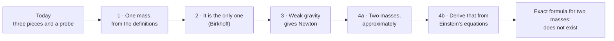

# Where this could go

Plan of 22 November 2026, written at the end of the session that produced this repository.
Marks as in [SURVEY.md](SURVEY.md): **Measured**, **Worked out**, **Open**, **Not verified**.
Effort is counted in agent-hours: one hour of one AI worker proving and compiling.

## The short answer

- **Go, on a smaller target: "one mass, from the definitions"** (steps 1 and 2 below). It is cheap,
  very likely to work, and as far as we could find nobody has done it by machine.
- **No-go on an exact formula for two masses circling each other.** Such a formula almost
  certainly does not exist. It is not the goal of this project and should not become it.
- **Not now: deriving the two-body equations from Einstein's equations by machine** (step 4b).
  The tools it needs do not exist yet, and even on paper the starting point is not agreed.
- **If the two-body wish stays:** step 4a is the honest smaller target. It checks the well-known
  *approximate* equations for two masses and what follows from them.

## What today showed

| | | Mark |
|---|---|---|
| From "go" to three proved pieces, a probe and a tested judge | about 40 minutes, roughly 10 of them waiting for a download | Measured |
| Size | 34 theorems, about 590 lines; all 70 declarations audited | Measured |
| Model use for that | about 45 model turns; roughly $15 to $20 at list prices for the top model, about $10 for the regular one | Measured |
| Machine | this PC, one build at a time; a rebuild takes about 10 seconds | Measured |
| Tries needed | each piece compiled within a handful of tries; the probe took four | Measured |

A warning that belongs right here: these were the easy pieces, chosen to be easy. The pace will
not hold higher up.

## The steps

| Step | What would be proved | What it needs first | Effort | Will it work? | Verdict |
|---|---|---|---|---|---|
| **1. One mass, from the definitions** | Compute the curvature of Schwarzschild's space-time from the general formulas (the ones the probe already uses), all 16 parts. Add the general equation for free fall and show the round orbit obeys it. This removes the first two "taken on trust" items in the README. | Nothing new. It is the probe again with four coordinates instead of two. | 5 to 20, most likely about 10 | Very likely | **Go** |
| **2. It is the only one** (Birkhoff's theorem, in coordinates) | Any round, empty space-time is Schwarzschild's, even if you allow it to change in time. In particular a round star that pulsates makes no gravity waves. | Step 1, plus arguments of the kind "slope zero everywhere means constant", which the standard library has. | 20 to 60 | Likely | **Go, after step 1** |
| **3. Weak gravity gives Newton** | Far from masses and at low speeds, Einstein's equations turn into Newton's law of gravity. | A careful way of saying "to first order". The statements need designing before anyone proves them. | 40 to 150 | Likely, once the statements are right | Decide after step 2 |
| 3 extra: the two classic numbers | Light passing a mass bends by `4M/b`. Mercury's orbit turns by 43 arc-seconds a century. | Limits of integrals, which are slower work than algebra. | 50 to 150 each | Likely | Optional |
| **4a. Two masses, approximately** | Take the Einstein-Infeld-Hoffmann equations of 1938 as the starting point and check what follows: the equations of motion, what stays conserved, the slow turning of the orbit. | Step 3 helps but is not required. | 60 to 200 | Likely | **The smaller target** |
| 4b. Derive those equations from Einstein's equations | The real thing. | A library for wave-like equations that does not exist yet, and one agreed meaning of "point mass", which physics does not have. | Thousands, plus specialists | Uncertain | Not now |
| 5. Higher steps of the approximation, stability of black holes | Research results of the last twenty years. | Everything above and much more. | Tens of thousands | Unknown | No |
| Exact formula for two orbiting masses | Not a step. | It would have to exist first. | n/a | n/a | **No-go** |

Two honest notes on this table.

- Step 2 is Birkhoff's theorem *in coordinates*: it starts from a space-time already written in
  round coordinates. The fuller version starts from "looks the same from every side" as a
  symmetry. That needs space-time geometry in the standard library and is not included.
- Step 4a checks the algebra *after* the hard step. It does not show that the starting equations
  follow from Einstein's. It should always be described that way.

## What the standard library lacks

Details and counts are in [SURVEY.md](SURVEY.md). In short: calculus is complete, connections on
curved spaces exist since 2025, but there is no curvature, nothing for space-time, no equation of
free fall and no Einstein equations. (Measured.)

That leaves two ways to work.

| | Own definitions, in coordinates | Building on the library |
|---|---|---|
| How | Write the classic textbook formulas as definitions, as the probe does. | First add space-time, curvature and free fall to the standard library or to the physics library. |
| Speed | Fast. Steps 1 to 4a can all be done this way. | Slow. Every addition is reviewed by people upstream. Months, not hours. |
| Strength | A physicist can read the definitions and recognise them. | Results connect to all other geometry in the library and help everyone. |
| Weakness | Tied to one set of coordinates. The poles and the rim of the black hole have to be left out. | We do not control the pace. |

Recommendation: work in coordinates, and do not wait for the library. When step 1 is done, offer
it to the experimental part of the community physics library (physlib), which already has one
file on Schwarzschild's solution and the same gap as ours.

## Where a swarm of workers helps, and where it does not

The idea: FACTORY hands out small jobs to many workers, and Lean decides who is done.

**Why Lean is a good judge.** A worker cannot talk its way past it. The check is one command,
`lake build`, and in this repository it already includes the audit that fails on any hole and any
extra assumption. That was tested with a planted hole. (Measured.)

**Jobs that fit a swarm.** Many small, independent lemmas whose statements are already fixed. Step
1 has about 64 connection parts and 16 curvature parts. Steps 2 and 3 have more. One job reads:
"prove this exact statement; you are done when the build is green".

**What the judge cannot do, so the rules must.**

| Risk | Rule |
|---|---|
| A worker weakens a statement until it is easy. | Statements live in files that workers may not change. A reviewer writes them. Workers only fill in proofs. |
| A worker adds an assumption. | The audit fails the build. Already in place. |
| A statement is wrong but provable. | Every statement gets a second reader before it becomes a job, and a "can the assumptions be met at all?" theorem where it has assumptions. (`roundOrbit_exists` is the example here.) |
| Two workers change the same file. | One file per job. |

**Where a swarm does not help.** Choosing what to state, and stating it correctly. That is design
work for one careful head. Nor does it speed up review by people upstream.

**Size it honestly.** Step 1 needs no swarm; one worker finishes it in a session or two. Step 2 is
the right size for a first trial with about five workers. A swarm really pays from step 3 on.

**Machines.** Every worker needs its own copy of the ready-built standard library (about 3.4 GB)
and a few GB of memory per build. This PC can run one build at a time, so a swarm cannot run here.
It would need cloud workers, and those cost money. None were started for this scoping.

## Cost

Model time is the cost. Machines are small change next to it.

Measured today: about $15 to $20 an hour at list prices with the top model, about $10 to $15 with
the regular one. The table uses $15 to $30 per agent-hour to leave room.

| Step | Agent-hours | At list prices |
|---|---|---|
| 1 | 5 to 20 | $75 to $600 |
| 2 | 20 to 60 | $300 to $1,800 |
| 1 and 2 together | 25 to 80 | about $400 to $2,400 |
| 3 | 40 to 150 | $600 to $4,500 |
| 4a | 60 to 200 | $900 to $6,000 |
| 4b | thousands | tens of thousands of dollars or more, with no promise of a result |

These are **Worked out, roughly**: the hourly figure is measured, the hours are estimates.

On the subscription instead of list prices there is no extra bill, but there is a weekly
allowance. After today the top-model allowance for this week stood at 92% used, and the Lean part
was roughly a tenth of today's use. So step 1 does not fit into what is left this week on the top
model. On the regular model it should fit into a normal week. (Rough; the exact link between
hours and allowance is not something we can measure from here.)

Cloud machines for a swarm were **not priced** today.

## Risks, said plainly

- **The pace will drop.** Today's pieces were picked because they were easy.
- **Right proof, wrong statement.** This is the real danger in all machine-checked work, and no
  tool removes it. Only reading does.
- **"First" is not verified.** We searched and found no machine-checked one-mass proof. Before
  saying so in public, ask in the Lean community chat.
- **Coordinates have blind spots.** The poles and the rim of the black hole are left out of every
  statement. That is normal in textbooks too, but it must be said.
- **Estimates are estimates.** Step 1 is well understood. From step 3 on, the ranges are wide on
  purpose.

## Recommendation

**Do step 1 next, alone, on this PC, on the regular model.** No swarm, no cloud, no spending
beyond the subscription. It is done when Pieces B and C no longer carry a "taken on trust" note
and the build is green.

Then decide about step 2 with real numbers in hand, and use it as the first swarm trial if FACTORY
is to be tested with Lean as the judge.

Leave step 4b and everything beyond it alone. And keep one sentence in view: **there is no exact
formula for two orbiting masses to find, so this project is not looking for one.**

### The next three moves

1. Ask the Lean community chat whether a machine-checked proof that Schwarzschild's solution
   solves Einstein's equations already exists. Five minutes for a person with an account.
2. Step 1: turn the probe's method on Schwarzschild's space-time.
3. Offer the result to the community physics library, and decide about step 2.
