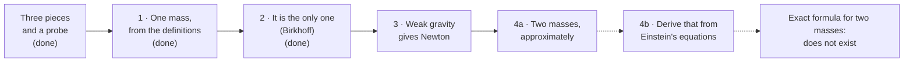

# Where this could go

Plan of 22 November 2026, written at the end of the session that produced this repository.
Marks as in [SURVEY.md](SURVEY.md): **Measured**, **Worked out**, **Open**, **Not verified**.
Effort is counted in agent-hours: one hour of one AI worker proving and compiling.

## Status

**Step 1 is done** (23 November 2026). It took 28 minutes and three builds, against an estimate of
5 to 20 agent-hours. See "What step 1 showed" below.

**Step 2 is done** (23 November 2026). It took about 20 minutes and six builds, against an
estimate of 20 to 60 agent-hours. See "What step 2 showed" below.

**The starting shape of step 2 is no longer assumed** (also 23 November 2026). "Looks the same
from every side" is now where the proof begins. That took about an hour and a half. See "What the
starting shape showed" below.

**The formulas no longer depend on the coordinates on trust** (also 23 November 2026). Curvature,
free fall and "unchanged by a turn" are each proved to give the same answer in any coordinates.
That took about an hour. See "What the coordinate question showed" below.

**The definitions for "Birkhoff with no coordinates" are written and tested** (also 23 November
2026): stream 0 of the work described under "Next" below, and the statements of stream 1. That
took about an hour. See "What the definitions showed" below. A build queue is in place.

**The first team of workers has run** (also 23 November 2026). One lead and nine workers, in one
container on this PC, proved the first statement of stream 1 (paths along a field depend
smoothly on where they start) in 14 minutes. See "What the first team trial showed" below.

**A second team has run** (23 November 2026, late evening). It proved the second statement of
stream 1, coordinates that fit the turns, in 17 minutes. Stream 1 is complete. See "What the
second team run showed" below.

**The goal is reached** (24 November 2026, 00:30 UTC). A third team proved Birkhoff's theorem
with no coordinates at all, `birkhoffNoCoordinates`, in 21 minutes. About four hours had passed
since the work on it began; the estimate was one to three weeks. See "What the third team run
showed" below.

**The theorem runs both ways** (24 November 2026, 01:19 UTC). A fourth team proved the "exactly
when" form, in coordinates and with none, in 11 minutes. See "What the fourth team run showed".

**The reviewers' list is done** (24 November 2026, 02:02 UTC). A fifth team proved the 25 tests
that the definitions can fail, one mass for a whole region, and "a length measure has a
connection" from the textbook, in 14 minutes. See "What the fifth team run showed".

**The rim is in** (24 November 2026, 02:51 UTC). A sixth team proved Birkhoff's theorem at
every point, with Kruskal's form as the target, in 29 minutes. See "What the sixth team run
showed".

**Next:** the theorem about a whole space-time at once (issue 39, second step). A second chat
is writing its statements. Then the checks of issue 34 before any public claim.

## The short answer

- **Go, on a smaller target: "one mass, from the definitions"** (steps 1 and 2 below). It is cheap
  and very likely to work. Both had been done in Lean before, which this plan first missed:
  step 1 at least twice, and step 2 in its simplest form (starting from the diagonal shape) by
  another project four days earlier (see [SURVEY.md](SURVEY.md)).
- **No-go on an exact formula for two masses circling each other.** Such a formula almost
  certainly does not exist. It is not the goal of this project and should not become it.
- **Not now: deriving the two-body equations from Einstein's equations by machine** (step 4b).
  The tools it needs do not exist yet, and even on paper the starting point is not agreed.
- **If the two-body wish stays:** step 4a is the honest smaller target. It checks the well-known
  *approximate* equations for two masses and what follows from them.

## What today showed

| | | Mark |
|---|---|---|
| From "go" to three proved pieces, a probe and a tested judge | about 40 minutes, roughly 10 of them waiting for a download | Measured |
| Size | 34 theorems, about 590 lines; all 70 declarations audited | Measured |
| Model use for that | about 45 model turns; roughly $15 to $20 at list prices for the top model, about $10 for the regular one | Measured |
| Machine | this PC, one build at a time; a rebuild takes about 10 seconds | Measured |
| Tries needed | each piece compiled within a handful of tries; the probe took four | Measured |

A warning that belongs right here: these were the easy pieces, chosen to be easy. The pace will
not hold higher up.

## What step 1 showed

| | | Mark |
|---|---|---|
| From "go" to a green build | 28 minutes, three builds | Measured |
| Size now | 79 theorems, about 1,300 lines; all 189 declarations audited | Measured |
| Model use | 8 model turns; roughly $10 at list prices for the top model | Measured |
| Against the estimate | 5 to 20 agent-hours were estimated. The real figure was under half an hour. | Measured |

Why the estimate was so far off: it assumed each of the sixteen parts would need a hand-made
proof. Writing every entry as "a function of the distance times a function of the angle" let one
short recipe do all of them. That is a gain from the design, not luck in the proving.

## What step 2 showed

| | | Mark |
|---|---|---|
| From the details to a green build | about 20 minutes, six builds; the two that failed did so on small things (a name clash, three names left folded) | Measured |
| Size now | 145 theorems, about 2,400 lines; all 332 declarations audited | Measured |
| Model use | not measured this time | |
| Against the estimate | 20 to 60 agent-hours were estimated. The real figure was under half an hour again. | Measured |
| Swarm | none. FACTORY 0.11.0 could have run 3 teams of 10 on local Docker; it was not used, because one worker was enough and this PC builds one Lean project at a time | Measured |

Why it went fast again: the same design. Every entry of the length measure and of its connection
is "a function of time and distance, times a function of the angle", so the step 1 recipe carried
over. The new kinds of work turned out to be short, because the standard library already had
them: "slope zero everywhere means constant" and "the order of two slopes does not matter" were
each a single library theorem, and only had to be translated.

## What the starting shape showed

Step 2 had one assumption that could be removed with the tools at hand: the shape of the length
measure. Removing it meant three things: deriving the general round shape from the symmetry,
redoing the curvature for that shape (with a cross term and a free sphere size), and building the
change of coordinates inside the proof.

| | | Mark |
|---|---|---|
| From the question to a green build | about an hour and a half, roughly 40 small builds | Measured |
| Size now | 281 theorems, about 5,200 lines; all 631 declarations audited | Measured |
| Method | every formula was first worked out with a computer algebra tool (sympy), which is not trusted, and then proved in Lean, which is | Measured |
| What the standard library supplied | the hard analysis step, "two slopes that fit together come from one function" (Poincaré's lemma), is in the library since 2025 | Measured |
| Tries needed | the two largest computations (connection and curvature of the general shape) compiled on the first try; the errors were small ones in the glue | Measured |

Why it went fast: the unknown formulas are the risky part of such a computation, and the algebra
tool removed that risk before any Lean was written. Lean then only had to confirm.

What it means for the steps below: their hours are probably too high as well. But step 3 contains
kinds of work steps 1 and 2 did not: limits ("to first order"), and statements that first have to
be invented. Read the hours as upper limits until measured.

## What the coordinate question showed

Everything above computes with formulas in coordinates. The first item of "taken on trust" was
that these formulas mean the same in any coordinates. That is now proved, for all three of them.
It is a different kind of work from steps 1 and 2: a general statement about any length measure
in any number of coordinates, not a computation for one space-time.

| | | Mark |
|---|---|---|
| From the question to the curvature theorem | 28 minutes | Measured |
| With the worked cases, free fall and symmetry as well | about an hour in all, about 30 builds | Measured |
| Size now | 375 theorems, about 7,400 lines; all 749 declarations audited | Measured |
| Estimate beforehand | none had been made | |
| Tries needed | the curvature proof took most of the builds, again with small errors in the glue and none in the mathematics; the free-fall and the symmetry proof needed one small fix each, and their worked cases compiled on the first try | Measured |

How it was done: no index was pushed around by hand where a table could do the work. The
connections, their slopes and the full curvature were written as square tables, so that the
cancellation at the heart of the proof became a few lines of table algebra. The standard library
supplied the two facts from analysis: the chain rule, and "the order of two slopes does not
matter".

What it rests on, said plainly: the change of coordinates has to be smooth near the point and
must lose no direction there. Nothing is assumed about the inverse of the length measure beyond
its existence. That it is smooth is proved (`contDiffAt_of_inverse`).

Each of the three theorems was then tested on a case whose answer was already known by another
route: Eddington's way of writing the black hole. Its emptiness, its roundness and its
free-falling orbit all follow from Schwarzschild's coordinates through the new theorems, and all
three agree with what step 1 and step 2 had computed directly.

What is still open here, and could be closed with the tools at hand: the two directions of
Birkhoff's theorem ("empty and round, so Schwarzschild's in other coordinates" and
"Schwarzschild's in other coordinates, so empty") are proved separately. Joining them into one
"exactly when" needs the new time label to be shown three times differentiable, which asks for
one more degree of smoothness in the setting, and a version of step 1 inside the rim.

## What the definitions showed

Stream 0 of "Birkhoff with no coordinates": say on a curved space, with no coordinates given,
what a space-time, its connection, its curvature, empty space, and "looks the same from every
side" are. Nothing may be built on such definitions before they are tested, so each was applied
to cases with known answers.

| | | Mark |
|---|---|---|
| From the request to a green build of everything | 57 minutes: 27 of reading the library and designing, 30 of writing and testing | Measured |
| With the second reading and what it led to | 80 minutes in all | Measured |
| Size now | 523 theorems, about 10,300 lines; all 1,089 declarations audited | Measured |
| New for this | about 2,900 lines, 148 theorems, in eight files | Measured |
| Tries needed | the definitions compiled at once; the errors were in the glue to the library's flat space, where a step and a plain vector are two types that happen to be equal | Measured |
| Known answers that passed | flat space-time, a sphere, de Sitter's and Schwarzschild's space-time: time direction, connection, curvature, emptiness, roundness | Measured |
| Second reading | two independent readers, one for the definitions and one for the statements; about 12 minutes each | Measured |

**How the tests work.** On coordinate space every new definition was shown to equal the
coordinate formula this project already uses (`Tables.lean`). The known answers computed in
steps 1 and 2 and in the two probes then carry over as they are. So the signs and the order of
the slots in the new definitions are pinned to curvatures that are known and not zero.

**One decision worth knowing.** The full curvature at a point is defined by continuing its three
steps to fields in the standard library's way, and computing with those. The textbooks prove that
any other way of continuing gives the same answer. Here that is proved on coordinate space
(`curvatureOfFields_flat_eq_curvatureAt`), not yet on an arbitrary curved space; the library has
no tool for it yet. It is part of stream 2.

**Why regions.** Every definition is stated on a region of the curved space, not on all of it:
the known answers come in coordinates that fail somewhere, and Birkhoff's theorem is about the
neighbourhood of a point. For a whole space the region is everything.

**What was written but not proved.** The goal (`BirkhoffNoCoordinates`), the two statements of
stream 1 (`SmoothFlowStatement`, `TurnsCoordinatesStatement`) and one of stream 2
(`ConnectionExistsStatement`). Each has a check that its assumptions can be met. They live in
files that workers may not change.

**What the second reading found.** Neither reader found a definition that says the wrong thing
where it is used, and both judged every statement true as written. They did find gaps, and each
was closed the same day:

| Found | Done about it |
|---|---|
| On a region with an edge, "its connection", "empty" and "combine the way turns do" say nothing at the edge: one could make de Sitter's space-time "empty" on a single point. | Regions are open by definition now (`IsConnectionOf`, `IsRoundOn`). |
| No test showed that "empty" can ever fail. Nothing ruled out a second, convenient connection. | Proved: a length measure has at most one connection, on any curved space (`connectionUnique`; this was one of the statements of stream 2). Proved: de Sitter's space-time is not empty (`deSitter_not_isEmptyOn`). For tables, empty in the new sense and empty in coordinates are now the same thing in both directions (`isEmptyOn_iff`). |
| The conclusion of the goal had never been tried on anything. | It holds for Schwarzschild's space-time with the chart that does nothing (`schwarzschild_meets_conclusion`). |
| "Unchanged along a field" gave a meaningless answer for a field that cannot be differentiated. | The definition now asks that it can. |
| The turns statement should say where the starting point lands. | It now puts it on the equator at angle zero. |
| The turns statement does not, as its comment claimed, make `shape_of_round` and `birkhoff_of_round` applicable: those ask for all angles, the statement gives a small patch. | The comment is corrected. Two more lemmas are needed and belong to stream 4: the shape of a round table on a small patch, and its continuation to all angles. |

**What the second reading could not settle, said plainly.** All tests are on coordinate space,
with the one chart that does nothing; nothing has been tried across a real change of charts.
There is no test that "looks the same from every side" or "usable distance" can fail. And the
check of the turns statement on Schwarzschild's own coordinates would not notice a table of
slopes written the wrong way round; that direction was checked by hand by the second reader.

## What the first team trial showed

The job: prove `SmoothFlowStatement`, fixed beforehand in `Goals/Turns.lean`. The team: one lead
and nine workers, all Claude Fable 5.2 at effort "high", in one Docker container on this PC, run
by FACTORY 0.11.0. One Lean run at a time for the whole team.

| | | |
|---|---|---|
| Result | proved: `smoothFlow`, 11 files, about 980 lines, 24 theorems and 5 definitions | Measured |
| Time, from "all ten are ready" to "the whole project builds with the proof in it" | 14 minutes 11 seconds (22:36:03 to 22:50:14 UTC) | Measured |
| Of that, the lead alone: reading the library, choosing the route, writing every lemma's statement | about 8 minutes | Measured |
| Of that, the nine workers proving their lemmas | 4 minutes, side by side (given out 22:45, last one built 22:49) | Measured |
| Jobs | 11 pieces: 9 by workers, 2 by the lead. Every worker's proof passed its first Lean run. No statement had to be changed. | Measured |
| The queue | 20 Lean runs, 1 failed (the lead's own first try). Waiting: 50 seconds on average, 3 minutes 22 seconds at most, 17 minutes in all, against 6 minutes of running. | Measured |
| Memory | 0.2 GB with all ten idle; about 8 GB at the busiest moment seen; the limit was 18 GB | Measured |
| Model use | 9.4 million tokens read (8.9 million of them from the cache), 178,000 written. The lead: half of it. | Measured |
| Weekly allowance | "all models" went from 37% to 39%, "Fable" from 28% to 31%, between the start of the trial and its end. That includes this chat's own use and the small check before. So: at most 2 and 3 points. | Measured |
| Getting ready | worker image 12 minutes to build, once; FACTORY's own layer on top 4 minutes, once; after that the ten were ready 6 seconds after the start | Measured |
| Checked afterwards on this PC | only `GravityInLean/Flows/` and eleven import lines changed; whole project rebuilt through the queue; all declarations pass the audit; `Audit.lean` now checks that `smoothFlow` proves the statement as it was fixed | Measured |

**What went wrong first.** A small check before the trial (one container, one short job) found
three faults in the set-up: the two scripts were not marked runnable, Lean was downloaded a
second time, and the shared standard library was not found and was downloaded too (20 minutes).
The cause of the last two: an agent's commands get only the search path and the home folder
from the image, no other setting. All three were fixed and re-tested before the trial (pull
request 25). Without the small check, ten workers would each have spent their first 20 minutes
downloading.

**What the supervisor changed afterwards.** Three of the team's files loaded the whole standard
library. That made a full rebuild take 7 minutes 35 seconds instead of under 2. They now load
only the parts they need, all eleven files have the project's usual form, and an assumption that
two files did not use is gone. Full rebuild now: 102 seconds, no warnings.

**What this says, and what it does not.**

- The fleet works on this PC, and nothing had to be taken on the team's word.
- The estimate was wrong again, in the same direction. This was to be "the smallest missing
  piece, to measure how long this kind of work takes". It took 14 minutes.
- The job was too small for the team. Nine workers were busy for 4 minutes. "Jobs per hour"
  from this run would be a made-up number: the run says how long this job took, not how much a
  team gets through in an hour of steady work. That needs a job that lasts an hour.
- Waiting for the queue was the only waiting, and it was nearly three times the running time while all
  nine built at once. Over the whole run it cost two or three minutes. One run at a time stays.
- The slow part of the whole undertaking was not the team. Writing and testing the definitions
  and the statements took one head 80 minutes; proving a statement took the team 14.

**Decided from this (step 4 of the order below).** One team at a time, on this PC. No cloud
machines: nothing here was short of memory or processors. A second team only makes sense when
there is a second goal that does not touch the first one's files, and the cost that matters is
the weekly allowance, not machines.

## What the second team run showed

The job: prove `TurnsCoordinatesStatement`, fixed beforehand in `Goals/Turns.lean`. Called "a
large job" in that file, and expected to take hours. Same kind of team as before: one lead and
nine workers, Claude Fable 5.2 at effort "high", one container on this PC. Two things were
different from the first run: the brief held a route worked out on paper (marked "not checked
in Lean"), and the workers' copies of the repository shared one build of the project.

| | | |
|---|---|---|
| Result | proved: `turnsCoordinates`, 20 files, about 2,070 lines, 62 theorems | Measured |
| Time, from "all ten are ready" to "the whole project builds with the proof in it" | 16 minutes 42 seconds (23:24:36 to 23:41:18 UTC) | Measured |
| How it went | 4 minutes: the lead reads and checks the route on paper. Then nine lemmas given out, built within 4 minutes. Then the goal proved from nine further lemmas still open. Then those nine given out, built within 3 minutes. | Measured (the team's record, checked against the queue's log) |
| Jobs | 20 pieces: 18 by workers in two rounds of nine, 2 by the lead. No statement had to be changed. Nobody was stuck. | Measured |
| Lean runs | 52 until the goal, 9 of them failed and were repaired (6 in the first round, 1 in the second, 2 by the lead) | Measured |
| The queue | After the set-up, the longest wait was 12 seconds. The set-up itself: one copy built the project (68 seconds), the other nine waited for it and took the result. | Measured |
| Memory | about 5.4 GB at the one moment sampled; the limit was 18 GB | Measured |
| Model use until the stop (13 minutes after the goal) | 16.6 million tokens read (15.8 million of them from the cache), 319,000 written. The lead: 40% of it. | Measured |
| Weekly allowance | "all models" went from 39% to 41%, "Fable" from 32% to 36%, between start and stop. That includes this chat's own use. So: at most 2 and 4 points. | Measured |
| Checked afterwards on this PC | only `GravityInLean/Turns/` and twenty import lines changed; whole project rebuilt from nothing through the queue, no warnings; all 1,243 declarations pass the audit; `Audit.lean` checks that `turnsCoordinates` proves the statement as it was fixed | Measured |
| Full rebuild now | 128 seconds with the library's files fresh in memory, 275 seconds straight after the run, when they were not; 7.8 GB at the peak, eight Lean processes | Measured |

**What the team did better than the route it was given.** The route found the place where the
resting field is zero through a unit vector that is only fixed up to its sign. The team used two
ordinary dot products instead: no division and no choice of sign. And it found that two of the
five assumptions are not needed: that the fields leave lengths unchanged, and that lengths are
positive. The statement is true with them and without them.

**What changed against the first run, and what it did.**

- The shared build: a worker's first Lean run took 3 to 5 seconds, not a minute, and after the
  set-up nobody waited more than 12 seconds. In the first run the waiting was three times the
  running. One run at a time is enough when the runs are short.
- The route in the brief: the lead needed 4 minutes before the first jobs went out, not 8, and
  the nine workers had work from then on.
- The files came back in the project's form, with no warnings. Nothing had to be tidied.

**What this says, and what it does not.**

- "A large job, several hours" took 17 minutes. Every estimate so far has been wrong in the
  same direction, by a factor of ten or more, so the estimates further down this page for the
  remaining streams should be read as "too high".
- An honest rate, at last: about 2,000 lines of checked proof and 20 lemmas in a quarter of an
  hour, for at most 4 points of the weekly allowance. But both runs ended because the job was
  finished, not because the time was up, so "per hour" is still an extrapolation.
- The team is no longer the slow part in any sense. What takes time is what comes before it:
  definitions, exact statements, a route, and the checking afterwards. Those were one head's
  work and took longer than the proving.
- Not checked: whether each lemma's comment says what its Lean statement says. The final
  theorem is safe, because its statement was fixed and read by two readers beforehand. The
  twenty lemmas in between were read by nobody but their authors.

## What the third team run showed

The job: prove `Curved.BirkhoffNoCoordinates`, the goal fixed in `Curved/Goal.lean` before any
team started. Same kind of team: one lead and nine workers, Claude Fable 5.2 at effort "high",
one container on this PC. The brief held a route in three parts, worked out on paper and marked
"not checked in Lean": from the curved space to a table in a chart; Birkhoff inside coordinates
on a small patch; joining the two.

| | | |
|---|---|---|
| Result | proved: `birkhoffNoCoordinates`, 24 files, about 4,500 lines, 168 theorems | Measured |
| Time, from "all ten are ready" to "the whole project builds with the proof in it" | 21 minutes 19 seconds (00:08:49 to 00:30:08 UTC) | Measured |
| How it went | Three rounds of ten, eight and five lemmas. After 9 minutes the goal was proved from its two halves with both still open, so every later lemma was known to be needed. | Measured (the team's record, checked against the queue's log) |
| Lean runs | 79 until the goal, 10 of them the set-up; 17 failed and were repaired | Measured |
| The queue | After the set-up, the longest wait was 34 seconds. The set-up: one copy built the project (109 seconds), the others took the result. | Measured |
| Idle hands | Four of the nine workers had nothing to do for the last five to seven minutes: nothing was left that the goal needed. One lemma was given to two workers as a hedge; the second copy was not needed. | Measured (the team's record) |
| Memory | 6.9 GB at the one moment sampled; the limit was 18 GB | Measured |
| Model use until the stop (7 minutes after the goal) | 39.2 million tokens read (37.6 million of them from the cache), 569,000 written. The lead: a third of it. | Measured |
| Weekly allowance | "all models" went from 42% to 47%, "Fable" from 36% to 46%, between start and stop. That includes this chat and a second chat that was busy at the same time. So: at most 5 and 10 points. | Measured |
| Checked afterwards on this PC | only `GravityInLean/Join/` and 24 import lines changed; whole project rebuilt from nothing through the queue; all 1,436 declarations pass the audit; `Audit.lean` checks that `birkhoffNoCoordinates` proves the goal as it was fixed | Measured |
| Changed afterwards | three loosely written steps in one file (`Signature.lean`) that gave style warnings. Nothing else. | Measured |
| Full rebuild now | 138 seconds with the library's files fresh in memory, 328 seconds straight after the run; 7.3 GB at the peak, eight Lean processes | Measured |

**What the team changed in the route it was given.**

- From the curved space to a table in two stops, not one: first to flat coordinate space in the
  curved-space language, then to tables. The chart lemmas need no tables, and the table
  dictionary needs no chart.
- "The shape on a small patch": the old proof reads one of the turns at a quarter turn around
  the axis, which lies outside any small patch. A worker found this and redid the proof at
  angle zero.
- The general theorem now gives a new time label that is smooth of every order
  (`birkhoff_general_smooth`). The old one was only shown differentiable once. That removes what
  stood in the way of the "exactly when" form.

**What the three runs say together.**

| Run | Job | Lines | Lemmas | Minutes | Allowance, at most |
|---|---|---|---|---|---|
| 1 | paths depend smoothly on their start | 980 | 24 | 14 | 2 to 3 points |
| 2 | coordinates that fit the turns | 2,070 | 62 | 17 | 2 to 4 points |
| 3 | the goal: Birkhoff with no coordinates | 4,500 | 168 | 21 | 5 to 10 points |

- The time hardly grew with the size of the job: the lead splits a larger job into more lemmas
  and more rounds, and the rounds take three to five minutes each. The cost grew roughly with
  the lines written.
- All of "Birkhoff with no coordinates" took about four hours from the request to the goal: 80
  minutes for one head to write, test and have read the definitions and statements; about an
  hour to set up the fleet and find its faults; three runs of 14, 17 and 21 minutes; the rest
  was checking, tidying and writing up. The estimate was one to three weeks.
- Where the time went is the lesson: not into proving. The slow parts were deciding what to
  prove, in exact words, and checking afterwards that what came back is what was asked for.
- What made it safe to go this fast: the statement of every final theorem was fixed in a file
  the teams could not change, was read by two readers and tested on known answers before any
  team started, and `Audit.lean` checks that the theorem proved is that statement and rests on
  nothing extra. A team could not have proved something else and called it the goal.

**What is not checked, said plainly.**

- Whether the definitions in `Curved/Basic.lean` and the goal say what a physicist means. Two
  readers and the known answers speak for it. Nobody who works in gravity has read them.
- The roughly 250 lemmas the teams wrote in between: their comments were read by nobody but
  their authors.
- Still no test that "looks the same from every side" or "usable distance" can fail.
- The symmetry is assumed in its small-steps form (three fields of arrows), not as a group of
  turns acting on the space.
- The theorem is a statement around a point. It says nothing at the rim and nothing about the
  whole space-time at once.

## What the fourth team run showed

The job: the six statements of `Goals/ExactlyWhen.lean` (issue 41). They were written by one
head in about twenty minutes and read by a second, independent reader in twelve, who judged all
of them true as written, checked in Lean that Schwarzschild's table is empty inside the rim
too, and asked for two more checks; both were added before the statements were fixed.

| | | |
|---|---|---|
| Result | proved: all six, 14 files, about 2,000 lines, 83 theorems | Measured |
| Time, from "all ten are ready" to "the whole project builds with the proofs in it" | 10 minutes 54 seconds (01:08:35 to 01:19:29 UTC) | Measured |
| Lean runs | 46 until the goal, 10 failed and repaired; longest wait after the set-up 6 seconds | Measured |
| Model use until the stop | 23.4 million tokens read (22.2 million from the cache), 361,000 written | Measured |
| Weekly allowance | "all models" from 48% to 51%, "Fable" from 47% to 53%, with this chat, a second reader and another chat busy at the same time. So: at most 3 and 6 points. | Measured |
| Checked afterwards on this PC | only `GravityInLean/BothWays/` and import lines changed; rebuilt from nothing, no warnings; all 1,557 declarations pass the audit; `Audit.lean` checks each of the six against its fixed statement | Measured |
| Changed afterwards | nothing in the Lean files | Measured |

**A side job was withdrawn.** The brief also asked the team to port another project's proof
that a length measure has a connection. During the run the project's owner asked for it to be
proved from the textbook instead, without reading that proof. A worker had already read it, so
the item was stopped and its files were left out of the repository. The statement stays open.

**What it adds to the picture.** The lead gave out seven pieces within two minutes of starting
(the brief now asks for that), and the workers' files came back in the project's form with no
warnings (the brief now asks for that too). The fourth run was the shortest although it had
six targets.

## What the fifth team run showed

The job: what three independent reviewers of the definitions asked for (`REVIEW.md`). Their 25
tests were copied as fixed statements; the one-mass statement was written by one head; a second
reader compared the copies with the reviewers' text and judged the one-mass statement true.

| | | |
|---|---|---|
| Result | proved: all 27 targets, 29 files, about 3,800 lines, 134 theorems. No test turned out false. | Measured |
| Time, from "all ten are ready" to "the whole project builds with the proofs in it" | 13 minutes 30 seconds (01:48:23 to 02:01:53 UTC) | Measured |
| Lean runs | 80 until the goal, 10 failed and repaired; longest wait after the set-up 49 seconds | Measured |
| Model use until the stop | 37.6 million tokens read (36.2 million from the cache), 411,000 written | Measured |
| Weekly allowance | "all models" from 51% to 56%, "Fable" from 53% to 61%, between the end of the fourth run and the end of this one, with this chat, a second reader and two other chats busy. So: at most 5 and 8 points. | Measured |
| Checked afterwards on this PC | only the three new folders and import lines changed; rebuilt from nothing, no warnings; all 1,798 declarations pass the audit; `Audit.lean` checks each of the 27 against its fixed statement | Measured |
| The connection, proved without looking | the record of the run shows no reach to the network at all, and no mention of the other project | Measured |

**What it settles.** Until now "empty" on a general curved space read "there is a connection of
the length measure, and its curvature vanishes", with the connection assumed. It is now proved
that there is one, and exactly one. And every notion in the goal now has a case where it fails.

## What the sixth team run showed

The job: the eleven statements of `Goals/EveryPoint.lean` (issue 39, first step): Kruskal's
table and its known answers, then Birkhoff's theorem at every point, the rim included. This
was the first job expected to need more than one run, because the rim needed mathematics the
project did not have: two labels along the light rays in the time-distance part.

| | | |
|---|---|---|
| Result | proved: all eleven, 24 files, about 4,700 lines, 155 theorems. None turned out false. | Measured |
| Time, from "all ten are ready" to "the whole project builds with the proofs in it" | 28 minutes 43 seconds (02:22:05 to 02:50:48 UTC) | Measured |
| How it went | The nine statements about Kruskal's table built after 18 minutes. The theorem was first proved from one lemma still open, then that lemma was closed. | Measured (the team's record, checked against the queue's log) |
| Lean runs | 72 until the goal, 13 failed and repaired; longest wait after the set-up 25 seconds | Measured |
| Model use until the stop | 47.4 million tokens read (45.7 million from the cache), 745,000 written | Measured |
| Weekly allowance | "all models" from 56% to 61%, "Fable" from 61% to 72%, between the end of the fifth run and the end of this one, with two other chats busy. So: at most 5 and 11 points. | Measured |
| Checked afterwards on this PC | only `GravityInLean/Rim/` and import lines changed; rebuilt from nothing, no warnings; all 2,004 declarations pass the audit; `Audit.lean` checks each of the eleven against its fixed statement | Measured |

**What the team changed in the route.** The route solved an ordinary equation with a singular
point to get the new labels. The team avoided that: a smooth function `Ω` of two labels with
`Ω · Ω_uv = Ω_u · Ω_v` and `Ω_uv ≠ 0` is a product of a function of the one label and a function
of the other, on the whole box and across its zeros (`Rim/Product.lean`). The new labels are
read off from that product.

**The six runs together.**

| Run | Job | Lines | Lemmas | Minutes | Allowance, at most |
|---|---|---|---|---|---|
| 1 | paths depend smoothly on their start | 980 | 24 | 14 | 2 to 3 points |
| 2 | coordinates that fit the turns | 2,070 | 62 | 17 | 2 to 4 points |
| 3 | the goal: Birkhoff with no coordinates | 4,500 | 168 | 21 | 5 to 10 points |
| 4 | the theorem both ways | 2,000 | 83 | 11 | 3 to 6 points |
| 5 | failure tests, one mass, the connection | 3,800 | 134 | 14 | 5 to 8 points |
| 6 | every point, the rim included | 4,700 | 155 | 29 | 5 to 11 points |

Six jobs, about 18,000 lines of checked proof, 106 minutes of team time, in one night. Each
statement was fixed and read by a second reader before its team started, and each result was
rebuilt from nothing afterwards. The allowance figures are upper bounds: other chats were busy
at the same time, and from the fourth run on they were busy most of the time.

**What is not checked, said plainly.** The same list as after the third run, shorter by what
the fifth run added: the definitions have now been read by three reviewers against the
textbooks and have failure tests, but still not by someone who works in gravity; the about
630 lemmas in between were read by nobody but their authors; the symmetry is assumed in its
small-steps form; and nothing is said about a whole space-time at once.

## Next: Birkhoff's theorem with no coordinates at all

Decided on 23 November 2026, before step 3: remove the last shortcut of step 2, with a small swarm
of workers. Step 3 waits.

**The goal.** A space-time is a curved space where time counts with the opposite sign to space.
Take one with four dimensions, that is empty, and that looks the same from every side: three
motions leave all lengths unchanged, combine the way turns do, and sweep out spheres. Then near
almost every point it is a piece of Schwarzschild's space-time. No coordinates are given at the
start; the proof has to find them.

**Why it is worth it.** It closes both items that are still "taken on trust" in the README at
once. Item 2, because the coordinates that fit the turns are no longer assumed. Item 1, because
the coordinate formulas for curvature and symmetry get tied to curvature defined on a curved
space, which is what the textbooks mean by them. And Lean's standard library has none of the
pieces this needs (see [SURVEY.md](SURVEY.md)), so they would be worth offering upstream on their
own. It is not new physics: the paper version is in Hawking and Ellis (1973), appendix B.

**The work, in five streams.**

| Stream | What | Needs first | Fits a swarm? |
|---|---|---|---|
| 0 · Definitions | A length measure with a time sign on a curved space; its connection; its curvature; "a motion that keeps all lengths"; "looks the same from every side". Each tested on cases with known answers (a sphere, de Sitter, Schwarzschild). | Nothing | No. One careful head, and a second reader |
| 1 · Coordinates that fit the turns ([#20](https://github.com/flujo-app/gravity-in-lean/issues/20)) | In coordinates: paths along a field that depend smoothly on where they start; Frobenius's theorem; any turning of a surface that combines like turns is, after relabelling, the turning of a globe. | Its statements only | Yes, a few big jobs |
| 2 · Curvature on curved spaces | The connection for a length measure with a time sign (the library's 414-line file assumes all lengths positive; that there is at most one is proved since 23 November), curvature, Ricci's part of it, and how all of them behave under motions that keep lengths. | Stream 0 | Yes, many small jobs |
| 3 · The bridge | In any chart, each object of stream 2 equals the coordinate formula this repository already uses. | Streams 0 and 2 | Yes, many small jobs |
| 4 · Joining | The goal, from streams 1 and 3 and `birkhoff_of_round`, carried back by the "any coordinates" theorems. Also two lemmas the second reading turned up: the shape of a round table on a small patch of angles, and its continuation to all angles. | Streams 1 and 3 | No |

Streams 1 and 2 can run side by side, so two teams can work from the start, and a third once
stream 3 opens. More teams than that would mostly wait for each other: five to ten teams would
not make it five to ten times faster.

**Machines, measured on 23 November 2026.**

| | | Mark |
|---|---|---|
| One Lean check that loads the library's curved-space parts | 6 seconds and 1.4 GB once the files are warm; 112 seconds the first time | Measured |
| One Claude Code worker on this PC | typically 0.2 to 0.35 GB; a long-running one up to 1.1 GB | Measured |
| Room on this PC | 8 processor threads, 32 GB of memory (13 GB free at the time), Docker allowed 19.5 GB, no containers running | Measured |

So Lean stays cheap and a build queue holds. This PC fits one team of ten with queued builds;
two would be tight. Five to ten teams would need cloud machines, which FACTORY can already start.
The real limit is the weekly model allowance, not the machine. FACTORY's own notes say to check
the AI plan's terms before running many agents on one subscription.

**Effort.** Not measured, and not like steps 1 and 2: those were calculations with known answers,
this is building general theory the library lacks. The first plan said months, at a person's
pace. A guess for a swarm: one to three weeks from start to finish, limited by the order of the
streams and by the allowance. Read it as a guess until the trial below has run.

**What the Riemann proof of November 2026 teaches here.** Its statement was already in the
standard library, so nobody had to trust a new definition; the work was all proof, and size was
no obstacle (17.4 million lines in about six weeks). Here it is the other way round. The proofs
are textbook material, and the risk is in the new definitions. That is why stream 0 is done by
one head, read twice, and tested on known answers before any worker starts.

**Order.**

1. Stream 0, and the statements of stream 1: one worker. **Done** (see "What the definitions
   showed").
2. A build queue for the fleet: one Lean build at a time on this PC. **Done:**
   `scripts/queued-build.sh`. Tested with three overlapping jobs: they ran one after another, and
   the log shows how long each waited. It is not strictly first come, first served.
   A worker image is built too (`fleet/Dockerfile`, 11.5 GB, with Lean and the ready-built
   standard library inside). Tested: a fresh copy of the repository inside a container built the
   whole project through the queue in 82 seconds, with every declaration passing the audit.
3. A trial: one team on stream 1. Measure jobs finished per hour and allowance used per hour.
   **Done** (see "What the first team trial showed"): the first statement of stream 1 is proved.
4. Then decide how many teams, and whether any run in the cloud. **Decided:** one team at a
   time on this PC, no cloud machines.
5. The second statement of stream 1, `TurnsCoordinatesStatement`, with the same kind of team.
   **Done** (see "What the second team run showed"). Stream 1 is complete.
6. Streams 2 to 4 and the goal itself. **Done** by the third team in one run (see "What the
   third team run showed"): the team wrote the statements of the join itself, from the route in
   the brief. Only the goal's statement was fixed beforehand.
7. The "exactly when" form, in coordinates and with none. **Done** by the fourth team (see
   "What the fourth team run showed").
8. From the review of the definitions (`REVIEW.md`): the tests, one mass, the connection from
   the textbook. **Done** by the fifth team (see "What the fifth team run showed").
9. The rim included (issue 39, first step). **Done** by the sixth team (see "What the sixth
   team run showed").
10. **Next: the theorem for a whole space-time** (issue 39, second step), in a chat of its own.
    Statements fixed in `Goals/Global.lean`: a round, empty space-time on a simply connected
    region maps into Kruskal's whole space-time (or flat space-time, or Schwarzschild's of
    negative mass) by a length-keeping map, unique up to a symmetry; the mass is fixed; and the
    other way round. Kruskal's is written with the unit sphere, so no pole is left out. A second
    reader judged every statement true as written; its findings were worked in before the
    statements were fixed. Checks proved in `Global/Checks.lean`. Brief in
    `fleet/goal-global.md`; item 9 is its local input. The classification (Kruskal's or one of
    its four quotients by a reflection, under a completeness condition) is **not stated**: it
    needs paths of free fall on a curved space, which neither this project nor the standard
    library has yet. The checks of issue 34 before any public claim.

## After Birkhoff: what could make a paper

Decided on 23 November 2026, from the research in [TARGETS.md](TARGETS.md). It changes the order
of the steps below: step 3 (Newton) stays useful, but these come first where they lead to a paper.

| Order | Target | Issue | Why |
|---|---|---|---|
| 1 | **Paper 1: the coordinate-free Birkhoff theorem and how the AI teams built it** | #34 | Not found elsewhere in that form. The coordinate version is not a first (ProjectAinos, 19 November 2026). |
| 2 | **A black hole that does not change in time is Schwarzschild's** (Israel, 1967) | #35 | Not found anywhere, no other project plans it, and its last step is our Birkhoff theorem. |
| 3 | **A singularity theorem, together with Lightlike** | #36 | Lightlike has most of the groundwork and lists it as its own goal. Racing it would likely lose. |
| 4 | **Check whether Lean has tools for exact error bounds** | #37 | The only realistic route to new mathematics found: computer-checked certificates for special solutions. |

Not now: positive mass, Penrose's inequality, the area theorem, stability of black holes, and the
famous open problems. Either another team is ahead (TauCeti, Lightlike) or years of foundations are
missing. The repository is public since 24 November 2026, 00:26 UTC, so our work is dated from then.

## The steps

| Step | What would be proved | What it needs first | Effort | Will it work? | Verdict |
|---|---|---|---|---|---|
| **1. One mass, from the definitions** | Compute the curvature of Schwarzschild's space-time from the general formulas (the ones the probe already uses), all 16 parts. Add the general equation for free fall and show the round orbit obeys it. This removes the first two "taken on trust" items in the README. | Nothing new. It is the probe again with four coordinates instead of two. | Estimated 5 to 20. Took under half an hour. | It did | **Done** |
| **2. It is the only one** (Birkhoff's theorem, in coordinates) | Any round, empty space-time is Schwarzschild's, even if you allow it to change in time. In particular a round star that pulsates makes no gravity waves. | Step 1, plus arguments of the kind "slope zero everywhere means constant", which the standard library has. | Estimated 20 to 60. Took about 20 minutes. | It did | **Done** |
| **3. Weak gravity gives Newton** | Far from masses and at low speeds, Einstein's equations turn into Newton's law of gravity. | A careful way of saying "to first order". The statements need designing before anyone proves them. | 40 to 150 | Likely, once the statements are right | **Next**: design the statements first |
| 3 extra: the two classic numbers | Light passing a mass bends by `4M/b`. Mercury's orbit turns by 43 arc-seconds a century. | Limits of integrals, which are slower work than algebra. | 50 to 150 each | Likely | Optional |
| **4a. Two masses, approximately** | Take the Einstein-Infeld-Hoffmann equations of 1938 as the starting point and check what follows: the equations of motion, what stays conserved, the slow turning of the orbit. | Step 3 helps but is not required. | 60 to 200 | Likely | **The smaller target** |
| 4b. Derive those equations from Einstein's equations | The real thing. | A library for wave-like equations that does not exist yet, and one agreed meaning of "point mass", which physics does not have. | Thousands, plus specialists | Uncertain | Not now |
| 5. Higher steps of the approximation, stability of black holes | Research results of the last twenty years. | Everything above and much more. | Tens of thousands | Unknown | No |
| Exact formula for two orbiting masses | Not a step. | It would have to exist first. | n/a | n/a | **No-go** |

Two honest notes on this table.

- Step 2 is Birkhoff's theorem *in coordinates*. Since 23 November it starts from "looks the
  same from every side", stated as: the three turns leave the length measure unchanged. What is
  still assumed is that coordinates exist in which the turns move only the two angles. The fully
  abstract version, which starts from a symmetry of a space-time without any coordinates, needs
  space-time geometry the standard library does not have. It is the next piece of work (see
  "Next: Birkhoff's theorem with no coordinates at all").
- Step 4a checks the algebra *after* the hard step. It does not show that the starting equations
  follow from Einstein's. It should always be described that way.

## What the standard library lacks

Details and counts are in [SURVEY.md](SURVEY.md). In short: calculus is complete, connections on
curved spaces exist since 2025, but there is no curvature, nothing for space-time, no equation of
free fall and no Einstein equations. (Measured.)

That leaves two ways to work.

| | Own definitions, in coordinates | Building on the library |
|---|---|---|
| How | Write the classic textbook formulas as definitions, as the probe does. | First add space-time, curvature and free fall to the standard library or to the physics library. |
| Speed | Fast. Steps 1 to 4a can all be done this way. | Slow. Every addition is reviewed by people upstream. Months, not hours. |
| Strength | A physicist can read the definitions and recognise them. | Results connect to all other geometry in the library and help everyone. |
| Weakness | Tied to one set of coordinates. The poles and the rim of the black hole have to be left out. | We do not control the pace. |

Recommendation: work in coordinates, and do not wait for the library. When step 1 is done, offer
it to the experimental part of the community physics library (physlib), which already has one
file on Schwarzschild's solution and the same gap as ours.

## Where a swarm of workers helps, and where it does not

The idea: FACTORY hands out small jobs to many workers, and Lean decides who is done.

**Why Lean is a good judge.** A worker cannot talk its way past it. The check is one command,
`lake build`, and in this repository it already includes the audit that fails on any hole and any
extra assumption. That was tested with a planted hole. (Measured.)

**Jobs that fit a swarm.** Many small, independent lemmas whose statements are already fixed. Step
1 has about 64 connection parts and 16 curvature parts. Steps 2 and 3 have more. One job reads:
"prove this exact statement; you are done when the build is green".

**What the judge cannot do, so the rules must.**

| Risk | Rule |
|---|---|
| A worker weakens a statement until it is easy. | Statements live in files that workers may not change. A reviewer writes them. Workers only fill in proofs. |
| A worker adds an assumption. | The audit fails the build. Already in place. |
| A statement is wrong but provable. | Every statement gets a second reader before it becomes a job, and a "can the assumptions be met at all?" theorem where it has assumptions. (`roundOrbit_exists` is the example here.) |
| Two workers change the same file. | One file per job. |

**Where a swarm does not help.** Choosing what to state, and stating it correctly. That is design
work for one careful head. Nor does it speed up review by people upstream.

**Size it honestly.** Step 1 needed no swarm: one worker finished it in half an hour. Step 2
needed none either: one worker, about 20 minutes. A swarm starts to pay from step 3 on, and only
once its statements are fixed.

**Machines.** Measured on this PC on 23 November 2026 (8 processor threads, 32.7 GB of memory):

| | | Mark |
|---|---|---|
| Checking one file | 1.2 to 1.3 GB of memory, 7 to 12 seconds | Measured |
| Rebuilding the whole project (not the standard library) | 102 seconds; at the peak 7.2 GB for all Lean processes together, up to seven at once. (Before the files on paths along a field: 107 seconds, 4.8 GB, six at once. Before the curved-space files: 81 seconds, 4.3 GB, four at once. Before the files about other coordinates: 46 seconds, 3.1 GB, three at once.) | Measured |
| The ready-built standard library | about 3.4 GB on disk; workers can share one copy, because they only read it | Measured (size), Worked out (sharing) |

So Lean is not the memory problem the first version of this plan assumed. A build is short, and
Lean already checks independent files side by side. Several *builds* at the same time only happen
when several workers each changed something and each want it checked. The usual build after a
change re-checks one or two files and stays near 1.3 GB. A full rebuild is the expensive case: ten
of those at once would now need about 48 GB, more than this PC has. A simple queue (one build at
a time per machine) avoids the question and costs little, because each build takes seconds.

**Decided for step 3 (23 November 2026): builds are queued, one at a time per machine.** No
cloud machine and no extra memory are needed for that. A queue costs little, because a build
takes seconds, and it keeps memory use at the level of a single build (about 5 GB at the peak,
as the project stands now). The queue exists since 23 November: `scripts/queued-build.sh`.
Several builds side by side stay possible later, if waiting for the queue ever becomes the slow
part.

Since 23 November FACTORY can run a small fleet on this PC's Docker (0.11.0, teams of one lead
and nine workers). Docker has about 19.5 GB of memory here: enough for a handful of builds at
once, and enough for a whole team if the builds queue. A cloud machine, for example on Azure,
would work the same way and is only needed for a larger swarm. None were started for steps 1 and
2, and no cloud machine was priced.

## Cost

Model time is the cost. Machines are small change next to it.

Measured today: about $15 to $20 an hour at list prices with the top model, about $10 to $15 with
the regular one. The table uses $15 to $30 per agent-hour to leave room.

| Step | Agent-hours | At list prices |
|---|---|---|
| 1 (done) | under half an hour | about $10 |
| 2 (done) | under half an hour | not measured |
| 3 | 40 to 150 | $600 to $4,500 |
| 4a | 60 to 200 | $900 to $6,000 |
| 4b | thousands | tens of thousands of dollars or more, with no promise of a result |

These are **Worked out, roughly**: the hourly figure is measured, the hours are estimates.

On the subscription instead of list prices there is no extra bill, but there is a weekly
allowance. Step 1 was expected not to fit into what was left of the week's top-model allowance.
It did fit, because it took a fraction of the estimated time. So did step 2. (The exact link
between hours and allowance is not something we can measure from here.)

Cloud machines: one example was looked up on 23 November 2026, on price lists that are not
Microsoft's own. An Azure machine with 16 processor threads and 64 GB of memory (D16as v5,
Linux, East US, pay as you go) is listed at about $0.69 an hour. That is small next to the model
time. **Not verified** on the provider's own page, and nothing was rented.

## Risks, said plainly

- **The pace will drop.** Today's pieces were picked because they were easy.
- **Right proof, wrong statement.** This is the real danger in all machine-checked work, and no
  tool removes it. Only reading does.
- **"First" is not verified, and for steps 1 and 2 it is wrong.** Step 1 had been done in Lean
  before (see [SURVEY.md](SURVEY.md), section 2). Birkhoff's theorem from the diagonal starting
  shape, outside the rim, was proved in Lean on 19 November 2026 by another project
  (`x-oai/ProjectAinos`, file `GeneralRelativity/Birkhoff.lean`; found on 24 November, four
  days after it was written). What we have not found elsewhere, as far as we looked: the
  version that starts from symmetry with no starting shape, and the one with no coordinates.
  That is "not found", not "first". Before saying anything of the kind in public, ask in the
  Lean community chat.
- **Coordinates have blind spots.** The poles are left out of every statement, and the rim of the
  black hole out of most. That is normal in textbooks too, but it must be said.
- **Estimates are estimates.** Step 1 is well understood. From step 3 on, the ranges are wide on
  purpose.

## Recommendation

**Steps 1 and 2 are done.** Pieces B and C no longer carry a "taken on trust" note, and
Schwarzschild's space-time is now proved to be the only round empty one, starting from the
symmetry itself. The formulas used on the way are proved not to depend on the coordinates.

**First, Birkhoff's theorem with no coordinates at all** (see the section of that name, issue [#21](https://github.com/flujo-app/gravity-in-lean/issues/21)). It
closes the two items still taken on trust, and it is the first real trial for FACTORY.

**Then step 3** (weak gravity gives Newton), but start with the statements, not the proofs.
"To first order" has to be said precisely before anyone proves it, and each statement needs a
second reader. Once the statements are fixed, step 3 is the better first trial for FACTORY with
Lean as the judge, because it has more independent pieces than steps 1 and 2 had.

Leave step 4b and everything beyond it alone. And keep one sentence in view: **there is no exact
formula for two orbiting masses to find, so this project is not looking for one.**

### The next three moves

1. Ask the Lean community chat whether a machine-checked proof of Birkhoff's theorem already
   exists. (One of Schwarzschild's solution does; see [SURVEY.md](SURVEY.md).) Five minutes for a
   person with an account.
2. Birkhoff's theorem with no coordinates: stream 0 and the statements of stream 1, then a trial
   with one team.
3. Offer steps 1 and 2 to the community physics library.

One thing that was open before step 3 is done: the formulas for curvature, free fall and
symmetry are proved to give the same answer in any coordinates (see "What the coordinate question
showed").
