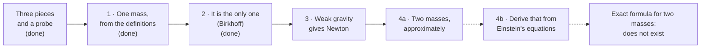
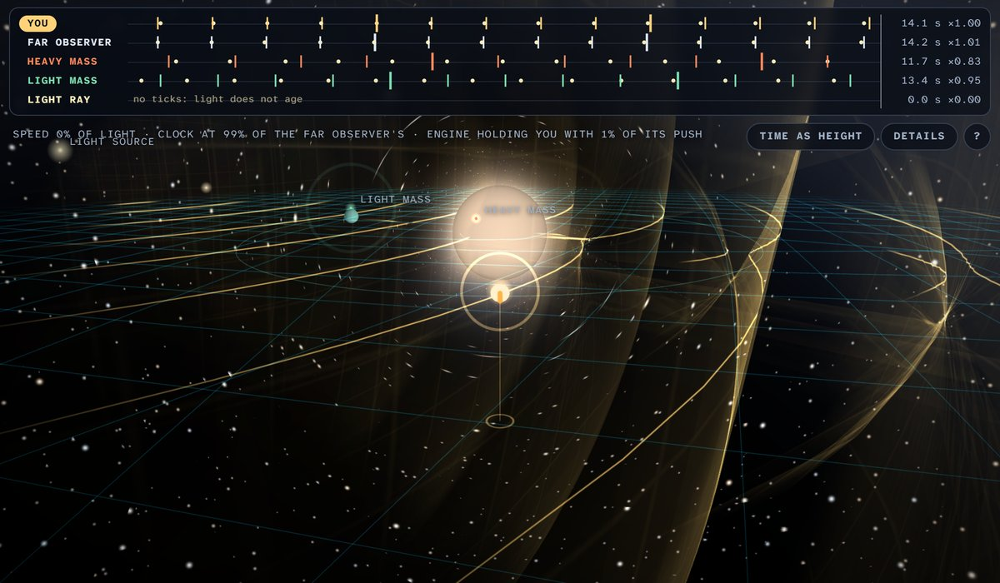

# Gravity in Lean

**Einstein's gravity, checked by machine, one small piece at a time.**

A proof checker called [Lean](https://lean-lang.org) reads every step of every proof in this
folder and refuses anything that does not follow. Mathematicians use the same tool for their
largest proofs. So the results below are not "the numbers agree" or "we think so". They are proved.

**Fly it in your browser:**
[Slow Clocks, Bent Light](https://flujo-app.github.io/gravity-in-lean/slow-clocks-bent-light.html),
the page this project grew out of, or [all eight pages](https://flujo-app.github.io/gravity-in-lean/).

[What is proved](#what-is-proved-today) ·
[What is taken on trust](#what-is-still-taken-on-trust) ·
[Check it yourself](#check-it-yourself) ·
[What exists elsewhere](SURVEY.md) ·
[Where this could go](PLAN.md)

## Why this exists

The formulas come from the interactive page
[Slow Clocks, Bent Light](https://flujo-app.github.io/gravity-in-lean/slow-clocks-bent-light.html), where you fly around
a heavy mass and watch clocks slow down and light bend. That page was tested with numbers. This
project asks the stricter question: can a machine confirm the formulas exactly? And how far up
could that go, perhaps as far as two masses circling each other?

The short answer: one mass, yes, and that part is now done in both directions. Schwarzschild's
space-time is empty, and it is the only round empty one: any space-time that looks the same from
every side and is empty turns out to be Schwarzschild's, whatever coordinates it was first written
in, and whether or not it seemed to change in time. The formulas all of this rests on, for
curvature, free fall and symmetry, are proved to give the same answer in any coordinates. Two
masses: an exact formula almost certainly does not exist, so that is not the goal. The honest
steps in between are in [PLAN.md](PLAN.md).



Solid arrows are steps worth taking. Dotted arrows are not for now.

## The pages

The interactive pages this project grew out of are online at
[flujo-app.github.io/gravity-in-lean](https://flujo-app.github.io/gravity-in-lean/), and kept as
files in [pages/](pages/): eight pages, each of which opens in a browser by itself, and one
picture. Start with *Slow Clocks, Bent Light*.

[](https://flujo-app.github.io/gravity-in-lean/slow-clocks-bent-light.html)

## What is proved today

| Piece | In plain words | File and main result |
|---|---|---|
| **A** | Two ways of writing how slowly a clock runs near a mass give exactly the same number: the page's `(1 - s)/(1 + s)` and the textbook's `√(1 - 2M/r)`. | [ClockRate.lean](GravityInLean/ClockRate.lean), `clockRateMap_eq_clockRateTextbook` |
| **B** | Schwarzschild's solution of 1916 makes all three curvature formulas for empty space vanish, everywhere outside the rim of the black hole. | [OneMass.lean](GravityInLean/OneMass.lean), `schwarzschild_isEmptySpace` |
| **C** | A clock on a round orbit runs at `√(1 - 3M/r)` of a far clock, and goes round at the rate Kepler found. Such orbits exist at every distance outside `r = 3M`. | [RoundOrbit.lean](GravityInLean/RoundOrbit.lean), `roundOrbit_clockRate`, `roundOrbit_kepler`, `roundOrbit_exists` |
| **The budget** | Speed through time, squared, plus speed through space, squared, always adds up to the same total. Light spends all of it on space. | [RoundOrbit.lean](GravityInLean/RoundOrbit.lean), `budget`, `budget_light` |
| **Step 1, curvature** | Take the general definition of curvature and apply it to a round, unchanging space-time. All sixteen parts come out: three of them are the formulas of Piece B, one is a multiple of the third, twelve are zero. So Schwarzschild's space-time is empty in the full sense of Einstein's equation. | [RoundSpacetime.lean](GravityInLean/RoundSpacetime.lean), `round_ricciFlat_iff`, `schwarzschild_ricciFlat` |
| **Step 1, orbit** | Take the general equation of free fall and apply it to a round orbit. Three of its four equations hold by themselves, the fourth is exactly a starting fact of Piece C. So the orbit's clock rate now follows from free fall itself. | [FreeFall.lean](GravityInLean/FreeFall.lean), `roundOrbit_isFreeFall_iff`, `roundOrbit_clockRate_of_freeFall` |
| **Step 2, curvature** | Let the clock and ruler functions also change in time, and apply the general definition of curvature again. All sixteen parts come out: Piece B's three formulas with new terms for the change in time, one new mixed part that measures how fast the ruler function changes, and the rest zero or a multiple. | [RoundChanging.lean](GravityInLean/RoundChanging.lean), `changing_ricciFlat_iff` |
| **Step 2, Birkhoff** | A round space-time, allowed to change in time, is empty exactly when it is Schwarzschild's: the ruler function is `1/(1 - 2M/r)` and the clock function is `1 - 2M/r` times a factor that depends on time only. On paper this is Birkhoff's theorem of 1923; Jebsen had found it two years earlier. | [Birkhoff.lean](GravityInLean/Birkhoff.lean), `birkhoff` |
| **Step 2, what it means** | Nothing measurable changes: the ruler function stays put, and clocks at two distances keep the same ratio of rates. So a round star that pulsates sends out no gravity waves. The time factor is only a choice of clock labels: re-set the far clocks and the space-time is Schwarzschild's, step for step, outside the rim. | [Birkhoff.lean](GravityInLean/Birkhoff.lean), `birkhoff_nothingChanges`, `birkhoff_resetClocks` |
| **Step 2, symmetry gives the shape** | "Looks the same from every side" is made precise: turning space around any of three axes leaves the length measure unchanged. A length measure with that property must have one particular shape, fixed by four functions of time and distance. And that shape does have the property. So the shape is exactly what the symmetry allows: nothing is lost, nothing is smuggled in. | [Symmetry.lean](GravityInLean/Symmetry.lean), `shape_of_round`, `genG_isRound` |
| **Step 2, the general shape** | That general shape has a cross term between time and distance, and the size of the spheres is free. The general definition of curvature gives all sixteen parts for it as well. In empty space they boil down to three equations for the size of the spheres. | [GeneralShape.lean](GravityInLean/GeneralShape.lean), [GeneralCurvature.lean](GravityInLean/GeneralCurvature.lean), `christoffel_gen`, `gen_ricciFlat_iff`, `sizeEquations` |
| **Step 2, without a starting shape** | A space-time that looks the same from every side and is empty is Schwarzschild's. Its mass can be read off anywhere from how fast the spheres grow, and is the same everywhere. There are new labels for time and distance in which every step has exactly Schwarzschild's length. This holds wherever the size of the spheres can serve as a distance; the places where it cannot (the rim) contain no region at all. | [BirkhoffGeneral.lean](GravityInLean/BirkhoffGeneral.lean), [BirkhoffFromSymmetry.lean](GravityInLean/BirkhoffFromSymmetry.lean), `massFn_const`, `usable_somewhere`, `birkhoff_general`, `birkhoff_of_round` |
| **Step 2, an example** | Eddington's and Finkelstein's way of writing a black hole has a cross term, no ruler function, and stays regular at the rim. Computed from the definitions it is empty everywhere, its mass reads `M` everywhere, and the theorem turns it back into Schwarzschild's form, outside the rim and inside it. | [Eddington.lean](GravityInLean/Eddington.lean), `eddington_isEmptyOn`, `eddington_mass`, `eddington_outside`, `eddington_inside` |
| **Any coordinates: curvature** | Write a length measure in other coordinates and compute its curvature again from the general definition. The result is the old curvature, re-written for the new coordinates, and nothing else. So "empty" means the same in every set of coordinates. This is proved for any length measure, in any number of coordinates, and for every change of coordinates that loses no direction. | [SlopeRules.lean](GravityInLean/SlopeRules.lean), [NewCoordinates.lean](GravityInLean/NewCoordinates.lean), `christoffel_inNewCoords_at`, `riemann_inNewCoords`, `ricci_inNewCoords`, `isRicciFlatAt_inNewCoords`, `isRicciFlatAt_changeOfCoords` |
| **Any coordinates: free fall** | A path that falls freely in one set of coordinates falls freely in every other, and its own clock keeps the same time in all of them. | [SamePath.lean](GravityInLean/SamePath.lean), `isFreeFallAt_inNewCoords`, `keepsOwnTimeAt_inNewCoords` |
| **Any coordinates: symmetry** | A move that leaves the length measure unchanged in one set of coordinates leaves it unchanged in every other. | [SameSymmetry.lean](GravityInLean/SameSymmetry.lean), `lieD_inNewCoords`, `leavesUnchangedAt_inNewCoords` |
| **One space-time, written in two ways** | The three theorems above, tested on a case with a known answer. Schwarzschild's length measure, re-written with Eddington's time label, is exactly Eddington's and Finkelstein's. So Eddington's is empty, looks the same from every side, and has the free-falling round orbit of step 1, each time without computing anything in Eddington's coordinates. The direct computations of step 2 agree. Birkhoff's theorem now also reads: an empty round space-time is Schwarzschild's length measure in other coordinates, entry by entry. And Schwarzschild's in any coordinates is empty. | [SameSpacetime.lean](GravityInLean/SameSpacetime.lean), `inNewCoords_toSchw`, `eddington_ricciFlat_from_schwarzschild`, `eddington_isRound_from_schwarzschild`, `eddington_orbit_freeFall`, `birkhoff_general_inNewCoords`, `schwarzschild_ricciFlat_inNewCoords` |
| **Curved space: the definitions** | The same notions, said on a curved space where no coordinates are singled out: a length measure with exactly one time direction, its connection, its curvature, empty space, a move that leaves all lengths unchanged, and "looks the same from every side". Definitions only, with a proof that "one time direction" really means one. | [Curved/Basic.lean](GravityInLean/Curved/Basic.lean), `IsSpaceTimeOn`, `IsConnectionOf`, `curvatureAt`, `ricciAt`, `IsEmptyOn`, `LeavesUnchangedAt`, `IsRoundOn`, `HasOneTimeDirection.not_orthogonal` |
| **Curved space: the two languages agree** | On coordinate space the new definitions turn into the coordinate formulas used everywhere else in this project. The textbooks' formula gives the connection of a length measure; its curvature is the formula `ricci`; "unchanged along a field" is Killing's equation; and the full curvature at a point does not depend on how its three steps are continued. | [Curved/Flat.lean](GravityInLean/Curved/Flat.lean), [Curved/Tables.lean](GravityInLean/Curved/Tables.lean), `isConnectionOf_table`, `ricciAt_table`, `leavesUnchangedAt_table_iff`, `curvatureOfFields_flat_eq_curvatureAt` |
| **Curved space: known answers** | The definitions, tested before anything is built on them. Flat space-time: one time direction, empty. A sphere: no time direction, curvature equal to its own length measure. De Sitter's space-time: one time direction, curvature `3/L²` times its length measure, and so not empty. Schwarzschild's: one time direction outside the rim and inside it (inside, it is the distance label), empty, and it looks the same from every side. | [Curved/KnownAnswers.lean](GravityInLean/Curved/KnownAnswers.lean), `flat_isEmptyOn`, `sphere_noTime`, `sphere_curvature`, `deSitter_curvature`, `deSitter_not_isEmptyOn`, `schwarzschild_isSpaceTimeOn_inside`, `schwarzschild_isEmptyOn`, `schwarzschild_isRoundOn` |
| **Curved space: only one connection** | A length measure has at most one connection: two of them agree on every field of arrows that can be differentiated. So curvature belongs to the length measure, and "empty" cannot be reached by picking a convenient connection. For tables of functions, empty in the new sense and empty in coordinates are the same thing, in both directions. | [Curved/Unique.lean](GravityInLean/Curved/Unique.lean), `IsConnectionOf.unique`, `connectionUnique`, `ricciAt_eq_of_isConnectionOf`, `IsRegularTableOn.isEmptyOn_iff` |
| **Paths along a field depend smoothly on where they start** | Follow a smooth field of arrows for a time `t` from a point `x`: where you end up is a smooth function of `t` and `x` together. Lean's standard library has the paths, and that they depend continuously on the start, but not this. Proved by a team of ten workers in the first fleet trial, in 14 minutes; the statement was fixed beforehand and the result was rebuilt and checked on this PC afterwards. The route: the paths are the solutions of one smooth equation on the space of all paths, and the library's theorem on solving smooth equations does the rest. | [Flows/SmoothFlow.lean](GravityInLean/Flows/SmoothFlow.lean), `smoothFlow`; the pieces are in [Flows/](GravityInLean/Flows/), the team's own record in [Flows/STATUS.md](GravityInLean/Flows/STATUS.md) |
| **Coordinates that fit the turns exist** | Start from any coordinates, and three fields of arrows that combine the way turns do and span two directions at every point. Then around every point there are new coordinates in which the three fields, after one fixed rotation among themselves, are exactly the three standard turns of a globe. This is the step the textbooks take for granted. Proved by a second team of ten workers in 17 minutes, from a route worked out on paper beforehand, which the team improved in one step; rebuilt and checked on this PC afterwards. It turned out to need less than was assumed: neither "the fields leave lengths unchanged" nor "lengths are positive" is used. | [Turns/TurnsCoordinates.lean](GravityInLean/Turns/TurnsCoordinates.lean), `turnsCoordinates`; the pieces are in [Turns/](GravityInLean/Turns/), the team's own record in [Turns/STATUS.md](GravityInLean/Turns/STATUS.md) |
| **Birkhoff's theorem, with no coordinates given** | Take a curved space of four dimensions with a length measure that has one time direction, is empty, and looks the same from every side. Then around every point where the size of the spheres can serve as a distance, there are a mass and a chart in which the length measure is Schwarzschild's, outside the rim or inside it. Nothing is said in coordinates at the start: no time label, no distance label, no angles. This was the goal fixed before any team started. A third team of ten workers proved it in 21 minutes from the pieces above and a route worked out on paper; it was rebuilt and checked on this PC afterwards. | [Join/Goal.lean](GravityInLean/Join/Goal.lean), `birkhoffNoCoordinates`; the statement is in [Curved/Goal.lean](GravityInLean/Curved/Goal.lean); the pieces are in [Join/](GravityInLean/Join/), the team's own record in [Join/STATUS.md](GravityInLean/Join/STATUS.md) |
| **Birkhoff's theorem, both ways** | The theorem as one "exactly when". With no coordinates: around a point, a length measure is a round, empty space-time whose spheres give a usable distance exactly when it is Schwarzschild's in some chart. On its own: Schwarzschild's in a chart is empty, outside the rim and inside it, with no symmetry assumed. In coordinates: a round table whose spheres give a usable distance is empty exactly when it is Schwarzschild's after new labels for time and distance. With checks that the assumptions can be met on both sides of the rim, and that "empty" can fail (de Sitter's universe). Proved by a fourth team in 11 minutes; statements fixed and read by a second reader beforehand; rebuilt and checked on this PC. | [BothWays/NoCoordinates.lean](GravityInLean/BothWays/NoCoordinates.lean), `schwarzschildExactlyWhen`, `schwarzschildIsEmpty`; [BothWays/InCoordinates.lean](GravityInLean/BothWays/InCoordinates.lean), `birkhoffExactlyWhenInCoordinates`; the statements are in [Goals/ExactlyWhen.lean](GravityInLean/Goals/ExactlyWhen.lean), the team's record in [BothWays/STATUS.md](GravityInLean/BothWays/STATUS.md) |
| **The definitions can fail where they should** | Twenty-five tests asked for by three independent reviewers of the definitions. On the rim of a black hole, in coordinates that are good there, every assumption of Birkhoff's theorem holds except "usable distance". Spheres of one fixed size are round but give no distance and are not empty. Three zero fields are not "round". Schwarzschild's with all signs turned round is empty but no space-time in the sense used here. Two time directions are not one. A squashed sphere is not round. De Sitter's universe meets every assumption except "empty", and is Schwarzschild's in no chart at all. Flat space-time with the turns written in ordinary `x`, `y`, `z` is round, poles included. No test turned out false. | [Checks/](GravityInLean/Checks/); the statements are in [Goals/Tests.lean](GravityInLean/Goals/Tests.lean), the reviewers' reasons in [REVIEW.md](REVIEW.md) |
| **One mass for a whole region** | On a region in one piece, the charts of Birkhoff's theorem all have the same mass, also on the two sides of a rim. The mass is said without coordinates. | [OneMass/Goal.lean](GravityInLean/OneMass/Goal.lean), `oneMass`; [OneMass/Mass.lean](GravityInLean/OneMass/Mass.lean), `MassAt` |
| **A length measure has a connection** | On any curved space, a length measure (of any signature) has a connection that belongs to it. With "at most one" from before: exactly one. So "empty" no longer rests on an assumed connection. Proved from the textbook (Koszul's formula). Another project, TauCeti, had proved the same earlier and independently; its proof was not read for this one. | [Connection/Exists.lean](GravityInLean/Connection/Exists.lean), `connectionExists` |
| **Birkhoff's theorem at every point, the rim included** | Around **every** point of a round, empty space-time, with nothing asked of the size of the spheres there, there is a chart in which it is Kruskal's form of Schwarzschild's space-time for a positive mass, or Schwarzschild's own form for a mass that is zero or negative. On a region in one piece the mass is the same everywhere. This covers the rim of a black hole and the place where the two rims cross, which Schwarzschild's own coordinates cannot reach. Known answers for Kruskal's table come with it: its radius is well defined and smooth; it is a space-time, empty and round, rim included; on the rim the size of the spheres is no usable distance; Schwarzschild's outside and inside are pieces of it; de Sitter's universe is not. Proved by a sixth team in 29 minutes, from a route worked out on paper that the team changed in one place. For the crossing point we did not find a complete written proof in the literature ([review/global-birkhoff.md](review/global-birkhoff.md)); "not found" is not "new". | [Rim/Goal.lean](GravityInLean/Rim/Goal.lean), `birkhoffAtEveryPoint`, `birkhoffAtEveryPointOneMass`; the statements are in [Goals/EveryPoint.lean](GravityInLean/Goals/EveryPoint.lean), the team's record in [Rim/STATUS.md](GravityInLean/Rim/STATUS.md) |
| **Birkhoff's theorem for a whole space-time** | A round, empty space-time on a region in one piece with no holes (simply connected) can be laid onto Kruskal's whole space-time (positive mass), flat space-time (mass zero) or Schwarzschild's of negative mass, by a map that keeps every length; the map need not be one-to-one. The map is unique up to a symmetry of that model, the mass is fixed by the space-time, and the other way round a space-time with such a map is round and empty. Kruskal's is written with the unit sphere, so no pole is left out. Checks: Schwarzschild's maps into Kruskal's by the textbook formulas; de Sitter's has no such map; uniqueness needs a region in one piece. Statements fixed and read by a second reader beforehand; proved by a seventh team in about 46 minutes (40 files); rebuilt from nothing and checked on this PC. In the research notes this was not found written down as a theorem; "not found" is not "new". | [Global/Glue.lean](GravityInLean/Global/Glue.lean), `globalBirkhoff`; [Global/Unique.lean](GravityInLean/Global/Unique.lean), `globalBirkhoffUnique`; the statements are in [Goals/Global.lean](GravityInLean/Goals/Global.lean), the checks proved beforehand in [Global/Checks.lean](GravityInLean/Global/Checks.lean), the team's record in [Global/STATUS.md](GravityInLean/Global/STATUS.md) |
| **Probes** | Two tests of the definitions on curvatures that are known and not zero. A sphere: its curvature comes out equal to its own length measure. De Sitter's space-time, an empty universe with a cosmological constant: its curvature comes out as `3/L²` times its own length measure, with the textbooks' sign, in the time direction too. | [Probe/Sphere.lean](GravityInLean/Probe/Sphere.lean), `ricci_sphere`; [Probe/DeSitter.lean](GravityInLean/Probe/DeSitter.lean), `ricci_deSitter` |

In numbers: 1,151 theorems in about 29,300 lines.

**What others did, and did first.** None of the physics here is new: it is textbook material
from 1916 to 1923. In Lean, Schwarzschild's solution had been checked before this repository,
at least twice. Birkhoff's theorem in coordinates, starting from a fixed diagonal shape, was
proved by `x-oai/ProjectAinos` on 19 November 2026, four days before the version here, and
`BrandonMYates/grlab` has the static last step (August 2026). `LightLikeProject/lightlike`
builds charts from the fields of a symmetry for the case of cosmology, and
`TauCetiProject/TauCeti` proved, earlier than this repository and independently of it, that a
length measure of any signature has a connection. What we
have not found elsewhere, as far as we looked: a machine check of Birkhoff's theorem from the
symmetry alone, with no starting shape, and with no coordinates given. On paper a proof that
avoids coordinates is known (H.-J. Schmidt, "A new proof of Birkhoff's theorem", 1997,
arXiv gr-qc/9709071), so what is added here is the machine check. "Not found" is not "first".
Details and dates: [SURVEY.md](SURVEY.md), [TARGETS.md](TARGETS.md). Three independent reviewers
read the definitions and the goal against the textbooks: [REVIEW.md](REVIEW.md).

## Stated, not yet proved

**Which whole space-times are round and empty (G2 of the research notes).** Fixed in
[Goals/GlobalComplete.lean](GravityInLean/Goals/GlobalComplete.lean), read by a second reader,
not proved. A round, empty space-time that is in one piece and Hausdorff, with a positive mass,
in which every path of free fall that cannot be continued either runs for all times or ends where
the spheres shrink to nothing, is Kruskal's whole space-time or Kruskal's folded in two in one of
four ways (one of them is the RP³ geon); if it is also orientable and can tell future from past,
it is Kruskal's or the RP³ geon. With it: the other way round, that Kruskal's whole space-time
and its foldings exist as curved spaces, that the equation of free fall does not depend on the
chart (proved), and failure tests (without "Hausdorff", without the condition on paths of free
fall, or without "in one piece", the statement is false). The steps of the route are stated too;
two of them are proved (a turn of the sphere leaves a point where it is; the only symmetry of the
sphere of order two that moves every point is the opposite-point map). The folded space-times are said without dividing anything: a
length-keeping map from Kruskal's whole space-time onto the space, whose points meet in pairs
exactly as the fold says. This project had no paths of free fall on a curved space before; they
are said through charts, with the coordinate equation of free fall used since step 1, and tested
in [Global/FreeFallChecks.lean](GravityInLean/Global/FreeFallChecks.lean): straight lines in
flat space-time are paths of free fall, a bent line and a kinked one are not, a ray of light
falling into Schwarzschild's mass is one and the same ray run at a wrong clock is not, a ray
inside the rim reaches the centre at a finite time while the spheres shrink to nothing, flat
space-time meets the condition, and the charts used for Kruskal's whole space-time reach every
point of it. Every other file of fixed statements (`GravityInLean/Goals/`) has a proof, and
`Audit.lean` checks each proof against its statement.

## What is still taken on trust

Before step 1 this list said: the three curvature formulas of Piece B, and the two starting facts
of Piece C. Both are now proved. What is left:

1. **The definitions themselves.** Curvature, free fall and "unchanged by a turn" are written
   down here as the classic textbook formulas in coordinates
   ([Curvature.lean](GravityInLean/Curvature.lean), [Symmetry.lean](GravityInLean/Symmetry.lean)).
   Lean's standard library has curved spaces, but no curvature on them yet. The link to it has
   begun: the same notions are now defined on a curved space
   ([Curved/Basic.lean](GravityInLean/Curved/Basic.lean)), and on coordinate space they are proved
   to be exactly the coordinate formulas ([Curved/Tables.lean](GravityInLean/Curved/Tables.lean)).
   That agreement along any chart of any curved space is now proved, as far as the goal needs
   it: "empty", the fields and their brackets, and the usable distance all carry over
   ([Join/](GravityInLean/Join/), `isRicciFlatAt_of_isEmptyOn`, `ricciAt_carry`). So the
   coordinate formulas are tied to the definitions on a curved space. Also proved: none of the three formulas depends on the
   coordinates (`ricci_inNewCoords`, `isFreeFallAt_inNewCoords`,
   `leavesUnchangedAt_inNewCoords`). That is the property the abstract definitions exist to
   guarantee.
   Two more things speak for the formulas: the two probes give the textbook answers, and the three
   fields of arrows are shown to be the three turns of ordinary space (`rotX_turns`, `rotY_turns`,
   `rotZ_turns`). What stays on trust is that these are the formulas the textbooks mean. That can
   be read, not proved.
2. **Coordinates that fit the symmetry: closed.** `birkhoffNoCoordinates` starts from a curved
   space with no coordinates at all; the coordinates that fit the turns are built inside the
   proof (`turnsCoordinates`). What it does assume about the symmetry, said plainly: three
   fields of arrows that leave the length measure unchanged, combine the way turns do, span two
   directions at every point, and have positive lengths there
   ([Curved/Basic.lean](GravityInLean/Curved/Basic.lean), `IsRoundOn`). That is "looks the same
   from every side" in its small-steps form. A group of turns acting on the whole space is not
   used and not assumed.
3. **The blind spots.** The two poles and the centre are left out of every statement in
   coordinates. (The theorem with no coordinates leaves out no point of the space-time for that
   reason: only the picture its chart draws avoids the poles.) The rim of
   the black hole is left out of the statements about new labels, because there the size of the
   spheres cannot serve as a distance; the statements "the mass is the same everywhere" and
   "Eddington's form is empty" do hold across it. The new labels are shown to be coordinates near
   every point, not to be one-to-one over a whole region. The theorems about other coordinates
   are statements at a point, for changes of coordinates that are smooth near it (three times
   differentiable for curvature, twice for free fall and symmetry). The theorem with no
   coordinates is a statement around a point: it gives a chart near every point where the size
   of the spheres is a usable distance, says nothing at the rim itself, and nothing about the
   whole space-time at once. Since then the rim is covered (`birkhoffAtEveryPoint`, with
   Kruskal's form) and the mass is one for a region in one piece (`oneMass`). What is still
   missing is a statement about the whole space-time at once; that is the next piece of work.
4. **Meaning.** Lean checks that a proof proves its statement. It cannot check that the statement
   says what we mean. That is why the statements are short and each has a plain-language comment:
   they are meant to be read. For the theorem with no coordinates this now rests on one file,
   [Curved/Basic.lean](GravityInLean/Curved/Basic.lean), and on the goal in
   [Curved/Goal.lean](GravityInLean/Curved/Goal.lean): they were read by two independent
   readers, then by three reviewers against the textbooks ([REVIEW.md](REVIEW.md)), and tested
   on known answers and on cases where they must fail, but not yet by someone who works in
   gravity. The lemmas
   the teams wrote in between (about 630) were read by nobody but their authors; that is safe for
   the final theorems, whose statements were fixed beforehand, and it means the lemmas should
   not be quoted on their comments alone.

## Check it yourself

On this PC Lean is already installed. It is not on the search path, so add it first:

```powershell
$env:PATH = "$HOME\.elan\bin;$env:PATH"
```

Then, in this folder:

```powershell
lake build
```

You should see `Build completed successfully` and eighteen lines that end in
`none rests on more than [propext, Classical.choice, Quot.sound]`. A full rebuild takes about two
minutes.

If several workers build on the same machine, they call `scripts/queued-build.sh` instead of
`lake build`. It lets one build run at a time and keeps a log of how long each one waited.

On another computer: install Lean from [lean-lang.org/install](https://lean-lang.org/install/),
then run `lake exe cache get` in this folder before `lake build`. That downloads the standard
library ready-built (the folder ends up at about 3.4 GB). Never let it build the standard library
from source; that takes hours.

This PC is shared and often short of memory, so please run one build at a time.

## The judge

Lean accepts a proof with a hole in it and only warns. It also lets anyone add a new assumption
and then "prove" anything from it. So "it builds" is not enough.

[Audit.lean](Audit.lean) closes both doors, and it is part of `lake build`. It asks Lean what each
of the 2,004 declarations in the project rests on (every definition and theorem, plus the helper
pieces Lean generates for them), and fails the build unless the answer is: nothing but Lean's own
three standard assumptions, the same three that almost all of the standard library uses.

It was tested, three times. A deliberately planted hole made the build fail, and the error named
both the theorem with the hole and a second theorem that merely used it. The test was repeated on
23 November 2026 with the files of step 2 in place, and once more with the files about other
coordinates: a hole in one helper was reported together with the four theorems that rest on it.

So a green build means three things at once: proved, no holes, no extra assumptions.

## Good to know

- **Units.** The speed of light and Newton's constant are both 1. A mass `M` is then a length:
  for the Sun, about 1.5 km.
- **Coordinates.** A point of space-time is four numbers: far time, distance, angle from the pole,
  angle around the axis.
- **Smooth enough.** Step 2 asks the functions in the length measure to be twice smoothly
  differentiable, the usual condition in the textbooks. It is written into the statement, not
  assumed in the background.
- **"Schwarzschild's, in other labels"** means: there are new labels for time and distance such
  that every step has the same length as Schwarzschild's length measure gives the same step in
  the new labels. What "the same step in new labels" is, is itself a theorem (`relabel_path`).
- **"The same length measure in other coordinates"** is `inNewCoords`: a change of coordinates
  turns the new coordinates of a point into its old ones, and the length of every step stays what
  it was (`length_inNewCoords`). "The curvature is only re-written" means: each of its two slots
  is multiplied by the table of slopes of the change of coordinates, as for the length measure
  itself.
- **Versions are pinned:** Lean 4.36.0 and its standard library mathlib v4.36.0. Updating either
  is a deliberate step, not something that happens by itself.
- **GitHub repeats the check** on a clean machine after every push
  ([check.yml](.github/workflows/check.yml)).
- **Licence:** Apache 2.0, the same as the standard library.

## Where things are

```
GravityInLean/ClockRate.lean        Piece A
GravityInLean/OneMass.lean          Piece B
GravityInLean/RoundOrbit.lean       Piece C and the budget
GravityInLean/Curvature.lean        the general definitions: connection, curvature, free fall
GravityInLean/RoundSpacetime.lean   step 1: the curvature of the round space-time
GravityInLean/FreeFall.lean         step 1: the round orbit as free fall
GravityInLean/TwoSlopes.lean        step 2: functions of time and distance, and their slopes
GravityInLean/RoundChanging.lean    step 2: the curvature of a round space-time that may change
GravityInLean/Birkhoff.lean         step 2: Birkhoff's theorem and what it means
GravityInLean/Symmetry.lean         step 2: the three turns, and the shape that symmetry allows
GravityInLean/GeneralShape.lean     step 2: the general round shape and its connection
GravityInLean/GeneralCurvature.lean step 2: its curvature, and the three size equations
GravityInLean/Potential.lean        step 2: a function with two given slopes (for the new time)
GravityInLean/BirkhoffGeneral.lean  step 2: the theorem for the general round shape
GravityInLean/BirkhoffFromSymmetry.lean  step 2: the theorem with no starting shape assumed
GravityInLean/Eddington.lean        step 2: an example with a cross term
GravityInLean/SlopeRules.lean       any coordinates: the rules for slopes, and the chain rule
GravityInLean/NewCoordinates.lean   any coordinates: the curvature formula does not depend on them
GravityInLean/SamePath.lean         any coordinates: nor does free fall
GravityInLean/SameSymmetry.lean     any coordinates: nor does "unchanged by a move"
GravityInLean/SameSpacetime.lean    any coordinates: all three, tested on the black hole
GravityInLean/Curved/Basic.lean     curved space: the definitions, with no coordinates given
GravityInLean/Curved/Unique.lean    curved space: a length measure has at most one connection
GravityInLean/Curved/Flat.lean      curved space: what they come to on flat space
GravityInLean/Curved/Tables.lean    curved space: tables of functions read as curved-space objects
GravityInLean/Curved/KnownAnswers.lean  curved space: tests on flat space-time, a sphere,
                                    de Sitter's and Schwarzschild's space-time
GravityInLean/Curved/Goal.lean      the goal, as a statement: Birkhoff with no coordinates
GravityInLean/Goals/Turns.lean      statements to prove: coordinates that fit the turns
GravityInLean/Goals/Connection.lean statements to prove: a length measure has one connection
GravityInLean/Goals/ExactlyWhen.lean statements to prove: Birkhoff's theorem both ways
GravityInLean/Goals/Tests.lean      statements to prove: tests that the definitions can fail
GravityInLean/Goals/OneMass.lean    statement to prove: one mass for a whole region
GravityInLean/Goals/EveryPoint.lean statements to prove: the theorem at every point, rim included
GravityInLean/Goals/Global.lean     statements to prove: the theorem for a whole space-time
GravityInLean/Global/Checks.lean    checks of those statements: assumptions met, known answers
GravityInLean/Goals/GlobalComplete.lean  statements to prove: which whole space-times are round
                                    and empty (G2), with paths of free fall on a curved space
GravityInLean/Global/FreeFallChecks.lean  checks of those definitions: free fall, foldings
GravityInLean/Global/FreeFallChart.lean   proof: free fall does not depend on the chart
GravityInLean/Global/FoldChecks.lean      more checks of the foldings; two facts on the sphere
GravityInLean/Flows/                paths along a field depend smoothly on where they start
                                    (eleven files; SmoothFlow.lean holds the theorem)
GravityInLean/Turns/                coordinates that fit the turns exist
                                    (twenty files; TurnsCoordinates.lean holds the theorem)
GravityInLean/Join/                 Birkhoff's theorem with no coordinates: from a curved space
                                    to a table in a chart, and back (24 files; Goal.lean holds
                                    the theorem)
GravityInLean/BothWays/             Birkhoff's theorem both ways, in coordinates and with none
                                    (14 files)
GravityInLean/Checks/               tests that the definitions can fail (8 files)
GravityInLean/OneMass/              one mass for a whole region (11 files)
GravityInLean/Connection/           a length measure has a connection (10 files)
GravityInLean/Rim/                  Birkhoff's theorem at every point, the rim included, and
                                    Kruskal's table (24 files; Goal.lean holds the theorem)
scripts/queued-build.sh             one build at a time, for several workers on one machine
scripts/setup-worktree.sh           gives a fresh copy of the repository the ready-built library
fleet/                              a team of workers: the image, the brief, the scripts that
                                    ran the first trial, and how to run it again
GravityInLean/Probe/Sphere.lean     probe: a sphere
GravityInLean/Probe/DeSitter.lean   probe: de Sitter's space-time
pages/                              the interactive pages

SURVEY.md                           what already exists elsewhere
PLAN.md                             where this could go, and what it would cost
```

## Learn more

- [SURVEY.md](SURVEY.md): what Lean's standard library has and lacks, who else has tried, and
  where physics itself stops. Every statement is marked measured, worked out, open or not verified.
- [PLAN.md](PLAN.md): the steps from here, the effort for each, where a swarm of workers helps, and
  a plain recommendation.
